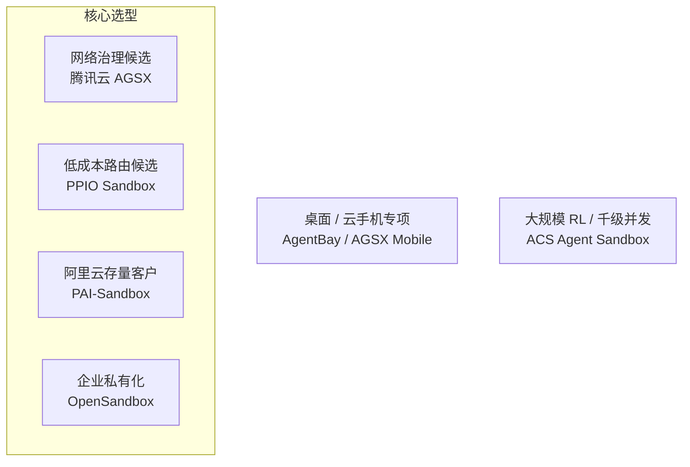
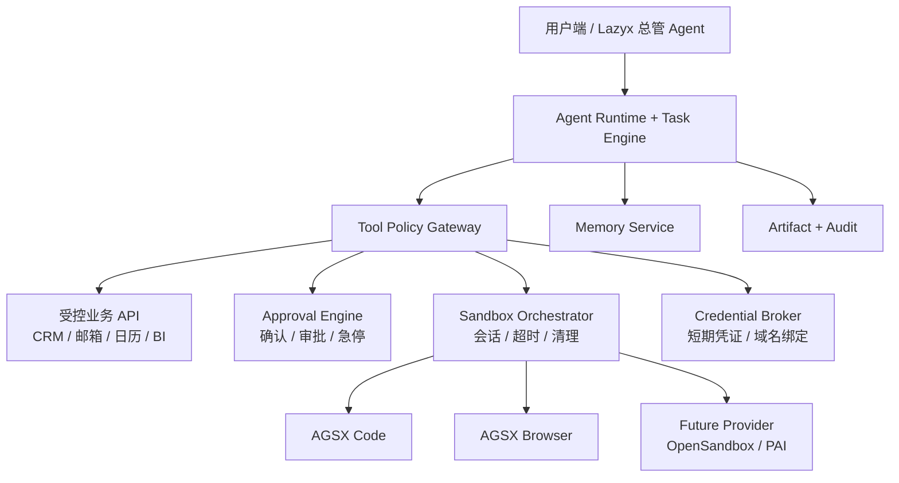

# Lazyx Agent Sandbox 候选方案与 POC 选型决策

*国内托管产品与开源自部署方案分析*

- **版本**：v1.2
- **日期**：2026-08-06
- **文档状态**：POC 选型评审稿，非生产采购决议
- **适用阶段**：POC / MVP 候选 / 企业私有化规划

> **当前决策**  
> 在公司没有既定阿里云基础设施约束的前提下，AGSX 与 PPIO 均已完成低风险 POC 同场评测。PPIO 优先作为低风险 Code/销售成本路由候选，AGSX 保留网络治理与国内云集成优势。生产默认 Provider 尚未决定，需等网络安全、扩大样本、真实账单和商务评审完成后做 Go/No-Go。

# 1. 执行摘要

> **一句话结论**  
> 业务 API 优先、沙箱按任务调用；先用托管方案验证业务闭环和安全边界，再根据真实成功率、成本和商务条件决定生产 Provider；第一阶段不自建底层运行时。

**POC 可用候选：腾讯云 AGSX 与 PPIO Agent Sandbox**

将 AGSX 放在第一个 POC 位置，不是因为它已在所有维度被证明绝对领先，而是它在 Lazyx 当前最重要的四个约束之间具有较好的文档上匹配：浏览器与代码场景覆盖、网络边界、国内企业交付、接入与迁移成本。这些优势仍需通过 POC 和商务材料确认。

| **决策层级** | **当前状态** | **说明** |
|------------------|--------------|----------|
| 技术路线 | 已决定 | MVP 优先托管执行面，不自建底层 Runtime |
| POC 主候选 | 已完成同场评测 | AGSX 与 PPIO 的 Code、销售和 Browser 固定矩阵均通过 |
| MVP 默认 Provider | 待决定 | 依赖 Browser、安全、成本、稳定性 POC |
| 生产与采购 | 待决定 | 还需 SLA、配额、合规、数据地域和商务审批 |

- PPIO Agent Sandbox：成本、Firecracker microVM、暂停恢复能力很有竞争力，但公开文档当前强调所有沙箱可访问互联网，尚未看到与 AGSX 同等明确的 SANDBOX/VPC/细粒度出口策略；更适合作为公开网页和低敏数据任务的成本对照。

- 阿里云 PAI-Sandbox：MicroVM 隔离与 VPC/安全组说明最清晰，但当前只开服华东 2（上海），暂停仍按运行状态计费；若公司主基础设施已在阿里云，应将其提升为首选。

- OpenSandbox：当前最值得关注的开源自部署平台，具备统一 API、Docker/Kubernetes Runtime、网络策略、Credential Vault 与多种强隔离 Runtime，但需要团队承担集群、镜像、安全、监控、弹性和 SLA。

- E2B Infra：开源且技术成熟，但自托管依赖 Terraform、KVM/Firecracker 及云基础设施，当前更适合具备专门平台团队的组织。




资料说明：本结论以 2026-08-06 可获取的官方产品文档、GitHub 仓库、Lazyx 产品规划和本项目固定矩阵实测为依据；公开能力与价格可能调整，正式采购前需用实际账单和商务材料复核。文档中应严格区分“官方文档声称”“Lazyx 实测”“架构推断”和“待商务确认”。

# 2. 产品背景与沙箱边界

Lazyx 的产品定位是“总管编排数字员工团队”：用户主要对接总管，由内容、营销、销售、客服、运营、财务、行政和数据等专员执行任务，并通过共享记忆持续成长。产品包含定时轮询、阈值触发和多源检索，且对付款、合同签署、对外发送等操作设置分级人机介入。

## 2.1 哪些能力需要沙箱

| **业务能力**                 | **推荐执行方式**      | **沙箱结论**     |
|------------------------------|-----------------------|------------------|
| 竞品官网、政策网站监控       | Browser Sandbox       | 需要             |
| 网页信息提取、截图、表单操作 | Browser Sandbox       | 需要             |
| Excel/CSV/财务报表分析       | Code/File Sandbox     | 需要             |
| 合同文件生成、格式转换       | Code/File Sandbox     | 建议             |
| CRM、邮箱、日历、BI 查询     | 受控业务 API          | 不需要           |
| 发送重要邮件、报价、付款     | Approval + 业务 API   | 沙箱不能替代审批 |
| 长期记忆、任务调度           | Memory / Task Service | 不需要           |

## 2.2 核心架构原则

- Agent 是逻辑角色，Sandbox 是短期执行资源；不要为每个专员长期保留一台沙箱。

- 长期存在的是 Task、Attempt、网页快照与审计记录；短期存在的是本次执行使用的 Sandbox Session。

- 高风险业务动作必须经过 Tool Policy 与 Approval，不能因为运行在沙箱里就自动获得付款、签署或批量外发权限。

- 真实长期凭据不进入沙箱。优先由沙箱外的 Credential Broker / Egress Proxy 在出站请求中注入凭据；只有无法代理的场景才给沙箱进程发放短期、最小范围、可撤销的 Capability Token。



原则：业务 API 优先；代码与浏览器按 Attempt 临时创建；高风险动作不由沙箱绕过审批。


# 3. 选型需求与权重

| **维度**       | **说明**                                          | **权重** |
|----------------|---------------------------------------------------|----------|
| 场景匹配       | 能否覆盖 Browser、Code/File，且适合短时与间歇任务 | 20%      |
| 安全隔离       | 是否具备 microVM/Kata/gVisor 等强隔离边界         | 15%      |
| 网络与凭据治理 | 默认断网、VPC、出口策略、身份凭证与密钥保护       | 15%      |
| 开发接入       | SDK/API、E2B 兼容、自定义模板、调试体验           | 10%      |
| 运维与弹性     | 创建速度、并发、生命周期、故障清理、监控          | 10%      |
| 成本           | 按秒/分钟计费、存储、暂停、成功任务成本           | 10%      |
| 状态能力       | 暂停恢复、快照、克隆、持久化                      | 5%       |
| 企业交付       | SLA、工单、合规、采购、地域与云生态               | 10%      |
| 可迁移/私有化  | Provider 替换难度、开源与自托管能力               | 5%       |

资料说明：权重是结合 Lazyx 当前 MVP 业务做出的内部工程判断，不是通用行业排名。若公司已确定云厂商或客户从第一天要求私有化，应调整权重。

# 4. 国内托管产品分析

## 4.1 腾讯云 AGSX

- 能力范围：Code、Browser、Mobile、OSWorld/桌面与自定义环境；提供 SDK、API、CLI、MCP，并兼容 E2B 使用方式。

- 网络治理：公开支持 PUBLIC、SANDBOX、VPC 三种模式；SANDBOX 不提供互联网或 VPC 出站。

- 治理体系：Agent Runtime 的产品方向同时覆盖 Agent Gateway 与身份凭证能力，与 Lazyx 的 Tool Policy / Credential Broker 分层方向相容；具体权限粒度与审计能力仍需 POC 和商务材料确认。

- 计费：CPU/内存按秒；1 vCPU + 2 GiB 约 0.4716 元/小时，不含超出免费额度的系统盘。暂停后 CPU/内存停止计费，系统盘后续将计费。

- 主要不足：计算单价偏高；公开材料对底层具体虚拟化实现的描述不如 PAI/PPIO 明确；公开网络文档未明确提供域名级出站白名单；SANDBOX 模式与 CLS 日志采集存在配置限制；Browser、Metadata 隔离与企业审计尚未实测。

## 4.2 PPIO Agent Sandbox

- 隔离与性能：Dockerfile 构建后转换为 Firecracker microVM 镜像；官方宣称启动低于 200ms。

- 状态能力：支持文件系统与内存级暂停/恢复、快照与克隆；暂停期间不计运行时间，恢复约 1 秒。

- 成本：1 vCPU + 2 GiB 约 0.216 元/小时；每实例 20GB 本地存储免费，持久化存储有账号级免费额度。

- 开发体验：支持 PPIO 原生 SDK，同时提供特定版本的 E2B 兼容接口；有 Browser Chromium 与 E2B Desktop 集成示例。

- 主要风险：公开“联网功能”文档写明每个沙箱可访问互联网并可提供公共 URL；入站 URL 是否默认需要认证应与出站网络风险分开验证。目前未在公开文档中看到与 AGSX SANDBOX/VPC 同等明确的完全断网与私网接入说明。默认并发 50，规格上限 8 vCPU/8 GiB。

## 4.3 阿里云 PAI-Sandbox

- 隔离：轻量 MicroVM，每个沙箱拥有独立 Guest OS 内核；明确提供文件系统隔离、网络出口控制和资源限制。

- 企业管理：Space/Template/Instance 三层模型，Space 绑定独立 VPC、交换机、安全组和访问凭证；提供 Web Terminal、VNC、文件管理和请求审计。

- 兼容性：原生兼容 E2B SDK，提供 Code Interpreter、Browser Use、Desktop GUI 模板。

- 计费：公共资源按分钟，1 vCPU + 2 GiB 约 0.242 元/小时，另计系统盘；暂停状态继续按运行状态计费。

- 主要限制：截至本次调研，公开文档显示仅开服华东 2（上海）。

## 4.4 阿里云 AgentBay 与 ACS Agent Sandbox

- AgentBay：提供 Browser、Code Space、Windows/Linux Computer、Android Mobile，适合无 API 的网页、桌面和移动 App 自动化，不应作为 MVP 普通 Code/Browser 的唯一默认平台。

- ACS Agent Sandbox：MicroVM、休眠、Checkpoint/克隆、每分钟最高 15K Sandbox，适合 Kubernetes、大规模并发与 Agent RL；当前为公测，运维与集群复杂度高于托管 API。

| **产品**    | **定位**              | **主要优势**                          | **主要限制**                   | **建议**       |
|-------------|-----------------------|---------------------------------------|--------------------------------|----------------|
| AGSX        | Browser/Code 默认托管 | 网络治理、Agent Gateway、国内企业交付 | 价格高、底层隔离公开细节较少   | 当前默认       |
| PPIO        | 低成本 microVM        | 价格、暂停恢复、快照克隆              | 网络治理公开能力待确认         | 低风险 POC 候选 |
| PAI-Sandbox | 阿里云 MicroVM 托管   | 隔离透明、VPC、控制台                 | 仅上海、暂停继续计费           | 阿里云客户优先 |
| AgentBay    | GUI/桌面/移动         | Windows/Linux/Android 全覆盖          | 成本与 UI 稳定性、非纯沙箱对照 | 专项使用       |
| ACS Sandbox | 规模化沙箱算力        | K8s、15K/min、Checkpoint              | 公测、运维复杂                 | 后期 RL/高并发 |

# 5. 开源与自部署方案分析

## 5.1 OpenSandbox

- Apache 2.0；提供多语言 SDK、CLI、MCP 和统一生命周期/执行协议。

- 内置 Docker 与 Kubernetes Runtime，支持命令、文件、Code Interpreter、浏览器和桌面示例。

- 提供每沙箱出口控制与 Credential Vault，可对接 gVisor、Kata、Firecracker 等强隔离 Runtime。

- 结论：是当前值得优先验证的企业私有化控制面候选，但不是已确认的生产底座。需固定经审查版本，验证其出站代理、Credential Vault、多租户边界和升级流程；第一阶段还需要承担集群、镜像、监控、弹性和故障恢复，不适合小团队直接取代托管服务。

## 5.2 E2B Infra

- Apache 2.0，开源 SDK 与基础设施；底层以 Firecracker/KVM 为核心，支持自托管。

- 自托管通过 Terraform 部署，当前官方支持 GCP，AWS 为 Beta；整体基础设施比普通 Docker 服务更重。

- 结论：协议和 SDK 很适合用作 Provider 抽象参考，但国内小团队第一阶段不建议直接自建完整 E2B Infra。

## 5.3 AIO Sandbox（agent-infra/sandbox）

- Apache 2.0；把 Browser、Shell、File、VS Code、Jupyter 与 MCP 集成进一个 Docker 容器，开发体验很好。

- 它首先解决的是“环境里有什么工具”，不是大规模多租户的控制面；官方快速启动示例使用 seccomp=unconfined，不能单独视为强安全边界。

- 结论：适合本地 POC、内部可信任务和作为沙箱镜像；生产环境应运行在独立控制面与经选型的强隔离 Runtime 之上。Kata、gVisor 和 Firecracker 是需根据威胁模型选择的替代项，不是默认同时组合使用。

## 5.4 低层 Runtime 不是完整产品

| **技术**        | **价值**                   | **边界**                             |
|-----------------|----------------------------|--------------------------------------|
| Docker/runc     | 轻量、生态成熟             | 共享宿主内核；适合 POC 或可信任务    |
| gVisor          | 用户态内核、比普通容器更强 | 兼容性与 I/O 性能需测试              |
| Kata Containers | 容器接口 + VM 隔离         | 资源与运维成本更高                   |
| Firecracker     | microVM、强隔离、快速启动  | 需要自行建设控制面、网络、存储、调度 |

> **关键判断**  
> 不要把“选择 Firecracker/Kata/gVisor”当成完成沙箱选型。它们只解决隔离 Runtime；你们仍需要生命周期、文件、网络、凭据、审计、资源调度和多租户控制面。

# 6. 加权评分与决策

先按“当前要解决的决策”对候选项分组，避免将托管 API、自建控制面、Kubernetes 算力和工具镜像当作同一类产品比较。

| **决策问题** | **同类候选** | **本轮结论** |
|--------------|--------------|--------------|
| MVP 托管 Provider | AGSX、PPIO、PAI-Sandbox | 进入加权评分与同场 POC |
| 企业私有化控制面 | OpenSandbox、E2B Infra | 保留为后续专项，不与托管 API 直接排名 |
| 桌面/移动专项 | AgentBay、AGSX Computer/Mobile | 非当前 Code/Browser MVP 主决策 |
| Kubernetes/RL 大规模算力 | ACS Agent Sandbox | 待出现大并发或 RL 需求再评估 |
| 本地工具环境/镜像 | AIO Sandbox | 可作为镜像或内部 POC，不作为多租户控制面 |

## 6.1 评分规则

- 能力分范围 0-10：0 表示不支持，5 表示部分支持或限制较多，8 表示官方文档上较完整，10 表示已经 Lazyx 生产验证并有可核对的 SLA/审计证据。

- 证据等级与能力分分开：`D`=官方文档，`P`=Lazyx POC，`C`=商务/SLA 材料，`R`=Lazyx 生产数据。

- 当前总分是用于安排 POC 顺序的先验，不是采购结果。任一安全硬门槛失败，都优先于总分。

| **托管方案** | **场景** | **隔离** | **网络** | **接入** | **运维** | **成本** | **状态** | **企业** | **迁移** | **先验总分** | **当前证据** |
|------------------|----------|----------|----------|----------|----------|----------|----------|----------|----------|--------------|--------------|
| 腾讯云 AGSX      | 9.0 | 8.5 | 9.5 | 9.0 | 9.0 | 6.0 | 8.0 | 9.0 | 6.0 | 8.50 | D + P（Code、销售、Browser） |
| 阿里 PAI-Sandbox | 8.0 | 10.0 | 9.0 | 8.0 | 8.0 | 8.0 | 6.0 | 9.0 | 6.0 | 8.35 | D |
| PPIO Sandbox     | 8.5 | 9.0 | 6.0 | 9.0 | 8.0 | 10.0 | 10.0 | 6.0 | 6.0 | 8.05 | D + P（Code、销售、Browser） |

资料说明：总分按第 3 节权重加权，数学计算已校验。AGSX 与 PAI-Sandbox 仅差 0.15 分，小于当前评分的主观误差，不能据此宣布最终胜出。如果公司已有阿里云 VPC、采购与数据合规前提，应重新调整企业交付、网络和成本分值。

## 6.2 为什么先验证 AGSX

1. 对 Lazyx 的核心用例覆盖最直接：Browser 负责竞品/政策/公开信息，Code 负责 Excel、财务和合同文件处理。

2. 具有明确的离线网络模式：PUBLIC、SANDBOX、VPC 边界在公开文档中较清晰，离线代码处理可用 SANDBOX 禁止公网和 VPC 出站；Browser 受控出站仍需单独验证。

3. 上层产品方向匹配：Agent Gateway 与身份凭证的分层，与自研 Tool Policy、Approval 与 Credential Broker 的架构相容，但不等于这些内部组件可以省略。

4. 国内云交付链路相对完整：云账号、VPC、对象存储和工单可用；SLA、合规和采购条款尚待商务确认。

5. 兼容主流社区接口，能降低初次接入成本；但迁移还取决于 Browser、网络、暂停和 Artifact 语义，因此仍需 Provider Adapter 保留 PPIO、PAI 和 OpenSandbox 的替换空间。

## 6.3 PPIO 的当前定位

PPIO 已从“纸面对照”升级为“低风险任务与成本路由候选”。相同固定样本下，Code+销售和 Browser 功能、Artifact、Receipt、并发与清理闭环均通过，且估算成本低于 AGSX；但 Lazyx 会处理客户、合同、财务、通讯等敏感数据，网络与凭据治理必须优先于单纯计算单价。当前 PPIO 公开文档写明每个沙箱可以访问互联网，而缺少与 AGSX SANDBOX/VPC 同等明确的公开治理说明，因此现阶段只批准公开网页和低敏 Code/销售任务 POC，不批准承载生产敏感数据。

## 6.4 什么情况下优先 PAI-Sandbox

PAI-Sandbox 的公开隔离与网络模型很完整，若公司核心数据和 VPC 已在阿里云，它很可能是更合理的选择。当前没有排在第一个 POC，主要因为公开地域仅上海、暂停继续计费，以及尚无明确的阿里云基础设施前提；这不是安全能力不足。

## 6.5 为什么不是开源项目直接上线

开源项目减少的是许可证与厂商依赖，不会自动消除基础设施成本。第一阶段直接使用 OpenSandbox/E2B 自托管，需要同时建设 Kubernetes、强隔离 Runtime、镜像供应链、网络出口、凭据代理、监控、容量、故障恢复和 SLA。对于正在同时开发 Agent Runtime、Memory、任务、通知和移动端的小团队，这会显著延迟业务闭环。

# 7. 推荐落地架构

## 7.1 Provider 抽象

以下 Rust 代码是语言无关的接口草图，不代表当前 TestAgent 已有 Rust 实现。真正的迁移边界不只是 `create/execute/terminate`，还必须显式处理能力差异、幂等、Artifact 与孤儿实例回收。

```rust
#[async_trait]
trait SandboxProvider {
    async fn capabilities(&self) -> Result<ProviderCapabilities>;

    async fn create(
        &self,
        ctx: RequestContext,
        spec: SandboxSpec,
        idempotency_key: &str,
    ) -> Result<SandboxHandle>;

    async fn execute(
        &self,
        ctx: RequestContext,
        id: &str,
        action: SandboxAction,
    ) -> Result<ExecutionResult>;

    async fn put_artifact(
        &self,
        ctx: RequestContext,
        id: &str,
        artifact: InputArtifact,
    ) -> Result<RemoteArtifact>;

    async fn get_artifact(
        &self,
        ctx: RequestContext,
        id: &str,
        artifact: RemoteArtifact,
    ) -> Result<OutputArtifact>;

    async fn status(&self, ctx: RequestContext, id: &str) -> Result<SandboxStatus>;

    async fn cancel(&self, ctx: RequestContext, id: &str) -> Result<()>;

    async fn terminate(&self, ctx: RequestContext, id: &str) -> Result<()>;

    async fn list_expired(
        &self,
        ctx: RequestContext,
        before: Timestamp,
    ) -> Result<Vec<SandboxHandle>>;
}
```

`ProviderCapabilities` 至少声明：沙箱类型、语言、网络模式、是否支持域名出站策略、暂停/恢复、文件上传下载、快照、并发和最大 TTL。业务要求某项能力而 Provider 未声明时，必须 fail closed，不得静默降级。

Provider 错误统一映射为内部错误分类：`INVALID_SPEC / QUOTA_EXCEEDED / CREATE_TIMEOUT / EXECUTION_TIMEOUT / EXECUTION_FAILED / ARTIFACT_FAILED / TERMINATE_FAILED / PROVIDER_UNAVAILABLE`。

Provider 实现：

- `TencentAgsxProvider`：POC 主候选。
- `PpioSandboxProvider`：成本和低风险任务对照。
- `AlibabaPaiProvider`：阿里云客户。
- `OpenSandboxProvider`：企业私有化。

## 7.2 沙箱模板划分

| **模板**                  | **类型**         | **网络**                | **用途**                            | **关键限制** |
|---------------------------|------------------|-------------------------|-------------------------------------|--------------|
| lazyx-code-offline        | Code Interpreter | SANDBOX                 | Excel/CSV、财务计算、合同文件、图表 | 无公网；不注入长期密钥；审计回执由控制面生成 |
| lazyx-browser-public-poc  | Browser          | PUBLIC                  | 竞品官网、政策网站、公开资料        | 仅限 POC/低敏数据；不声称具备原生域名白名单 |
| lazyx-browser-restricted  | Browser          | VPC + 受控 Egress Proxy | 生产公网访问候选                  | 待验证；需阻断直连公网、Metadata、IP/IPv6 绕过和 DNS 重绑 |
| lazyx-browser-login       | Browser          | VPC + 站点策略        | 需要登录的第三方网页                | 加密 Profile；优先由代理注入短期凭据；非 MVP |
| lazyx-computer            | Computer         | VPC + 受控出站          | 无 API 的桌面系统                   | 非 MVP；必须支持人工接管 |

## 7.3 生命周期

```text
Task（长期）
└── Attempt（一次触发）
    └── 0..N SandboxSession（临时）
        ├── InputArtifact
        ├── Execution
        ├── OutputArtifact
        └── ExecutionReceipt

CREATING → READY → RUNNING → COLLECTING → TERMINATING → TERMINATED
异常：CREATE_FAILED / TIMED_OUT / EXECUTION_FAILED / CANCELLED / TERMINATE_FAILED / ORPHANED
```

- 竞品监控可以持续数月，但每次轮询创建短期 Browser Session，结果与快照保存到 Artifact Store。

- 用户确认等待优先保存结构化状态并销毁沙箱；只有无法序列化的复杂进程或桌面状态才使用 pause。

- Cleanup Worker 持续扫描超时和孤儿实例。“清理率 100%”是验收目标，不是系统尚未验证时的保证；必须配套厂商实例列表对账和超时告警。

# 8. POC 与实施计划

## 8.1 当前实现基线（2026-08-06）

| **能力** | **状态** | **证据/限制** |
|----------|----------|---------------|
| AGSX Code create → run → kill | 已实现、已实测 | `scripts/agsx_smoke.py`、`scripts/agsx_poc.py`、`scripts/agsx_code_report.py` |
| Python、JavaScript、上传/下载、哈希 | 已实测 | 真实实例执行通过；报告保存 Instance ID、各阶段耗时和销毁结果 |
| Code SANDBOX 公网探测 | 已通过单轮 POC | DNS 可解析，公网 TCP 连接失败；仍需扩大协议、IP、IPv6 与重复样本 |
| Agent Loop 沙箱工具 | 已实现、已实测 | `run_code`、`analyze_sales_csv`、`browse_public_page` 已由模型真实调用；一次调用一个沙箱，不保留跨调用状态 |
| 本地自动化测试 | 63 passed | 为离线单元/协议测试，不等于厂商可用性测试；包含 Gateway HTTP/幂等/租户隔离、重启恢复和孤儿扫描测试 |
| 销售 CSV 业务闭环 | 已实现、已实测 | 输入归档 → 上传 → 沙箱分析 → JSON/SVG → SHA256 → Receipt → 销毁 |
| Browser Sandbox | 已实现、已实测 | `lazyx-browser-public-poc`（PUBLIC）可用；公开页面、截图、Cookie 隔离和保留地址观测通过；新增 DNS 解析私网拦截，受控 DNS rebinding 实验结果 inconclusive，不能宣称完整防护 |
| Provider Adapter / Artifact / Receipt / Cleanup Worker | 最小版本已实现并补齐 run_code 回执 | `TencentAGSXProvider`、本地原子 Artifact Store、销售/Browser/Code 工具 Receipt、带项目标签的过期实例清理；非生产服务 |
| 固定评测框架 | 已实现、已完成 Code/Browser 各 30 实例 AGSX 基线 | `evals/runner.py` 统一记录成功率、95% Wilson 区间、清理率、P50/P95、并发和成本估算；最终合并 63/63 通过，但不代表生产 SLA；报告 `artifacts/evals/eval-20260806T032636Z-6d1fdc70/` |
| 多租户隔离 / 超时清理 | 已完成 AGSX POC | `agsx_isolation_poc.py` 验证两个 tenant 同路径文件隔离、Metadata 绑定、`EXECUTION_TIMEOUT`、销毁后文件不可读和 3/3 清理；仍不是生产级串扰全量测试 |
| PPIO / PAI 同场对照 | PPIO Code+销售与 Browser 对照已完成 | PPIO Code+销售 33/33、Browser 30/30 通过且清理 63/63，评测后残留为 0；Code+销售 P95 1,904 ms、每成功任务 0.000168 元，Browser P95 4,632 ms、每成功任务 0.000500 元；PAI 未评测 |
| 可复用 Sandbox Gateway V0 | 已实现、已验证（PPIO Code E2E） | `services/sandbox-gateway/` 提供 FastAPI REST；`packages/sandbox-client/` 提供同步/异步 SDK；支持 API Key、租户/Agent 归属、幂等提交、上传/下载、Code/销售/公开 Browser、查询/取消、Artifact、Receipt、重启恢复和项目标签孤儿扫描；真实 PPIO Code E2E 成功且扫描无遗留；当前为 SQLite、本地文件和进程内线程池，不是生产部署 |

## 8.2 四周收敛计划

| **周期** | **目标** | **必须交付** | **明确不做** |
|----------|----------|--------------|--------------|
| 第 1 周 | 固化 Code POC（已完成） | 基于现有脚本生成可归档报告；补 JS、上传/下载、哈希、超时、销毁证明；完成最小 `TencentAgsxProvider` | 不建完整 HTTP 平台 |
| 第 2 周 | 一个业务闭环（已完成） | 销售 Excel/CSV 上传 → AGSX 分析 → JSON/图表 Artifact → Receipt → 销毁；最小孤儿回收 | 不同时做合同 DOCX 和多租户平台 |
| 第 3 周 | Browser Go/No-Go（已完成） | Browser Tool、CDP/Playwright、标题/正文、截图、Metadata、内网、重定向、IP/IPv6、Cookie 与 Prompt Injection 已完成单轮实测；受控 DNS rebinding 已尝试但 inconclusive | 不做登录态 Profile 生产化 |
| 第 4 周 | 对照与决策（已完成） | AGSX 与 PPIO 使用相同 Fixture、并发、成功定义和 2 vCPU/4 GiB 计费口径；输出 Code+销售及 Browser 对比、回执审计和 Go/No-Go | 不宣称已达生产 SLA |
| 第 5 阶段 | 可复用 Gateway V0（已完成本地版） | REST + Python SDK；鉴权、幂等、租户隔离、文件交换、三类任务、状态/取消、Artifact/Receipt；补接入示例和离线测试 | 不做生产级队列、身份系统、对象存储和网络安全承诺 |

Tool Policy、Approval Engine、完整 Credential Broker、多 Provider 生产路由、合同 DOCX、登录态 Browser Profile 与私有化部署，延后到 POC 决策之后。

Gateway V0 的接入方式和启动命令见 `doc/沙箱网关接入指南.md`。它是给多个
Agent 复用的执行边界，不把 Provider 密钥下发给 Agent；后续生产化需要单独建设
身份系统、配额、持久队列、对象存储、孤儿恢复和网络安全策略。

## 8.3 同场对照

同一批固定任务已完成 AGSX 与 PPIO 对照：Code+销售两边均 33/33 通过，Browser 两边均 30/30 通过，清理率均为 100%。在本轮样本中，PPIO Code+销售的 P95 为 1,904 ms（AGSX 2,244 ms），每成功任务估算 0.000168 元（AGSX 0.000445 元）；PPIO Browser P95 为 4,632 ms（AGSX 4,450 ms），每成功任务估算 0.000500 元（AGSX 0.000961 元）。Browser 30 个 URL 当前仍是 `example.com` 同源的 200/404 矩阵，只证明重复导航与清理，不等于 30 个不同网站的反爬/兼容性覆盖。若公司已有阿里云账号和必要权限，再加入 PAI-Sandbox。这批任务用于功能和兼容性 POC，不用于证明 99% 可用性；成本仍需实际账单复核。

| **类别**         | **测试重点**                                                   |
|------------------|----------------------------------------------------------------|
| 功能             | 代码执行、文件上传下载、CDP/Playwright、截图、输出 Artifact    |
| 安全             | SANDBOX 出网、VPC/内网、Metadata、跨用户文件、环境变量、Cookie |
| 可靠性           | 无限循环、浏览器崩溃、SDK 超时、服务重启、Kill 失败、孤儿回收  |
| Prompt Injection | 恶意网页诱导读取密钥、访问内网、外传 Cookie、调用高风险工具    |
| 性能             | 创建/恢复 P50/P95、执行总时长、10/30/50 并发成功率             |
| 成本             | 计算、存储、流量、重试、暂停；最终按成功任务计算               |
| 治理             | Task/Attempt/Sandbox ID 关联、日志脱敏、审计覆盖率、权限与审批 |

## 8.4 验收门槛与统计口径

| **类型** | **指标** | **POC 门槛** | **证据口径** |
|----------|----------|--------------|--------------|
| 功能 | Code 固定任务 | 30/30 完成预期功能 | 固定 Fixture、预期输出、ExecutionReceipt 和 Artifact 哈希 |
| 功能 | 静态网页提取 | ≥ 95% | 至少 30 个固定页面，记录失败类型，不将网站反爬简单归因于 Provider |
| 稳定性 | Code 调用成功率 | POC 后再设生产门槛 | 至少数百次调用，报告样本数、成功率与 95% 置信区间；30-50 个样本不足以证明 ≥99% |
| 安全 | SANDBOX 出网成功次数 | 0 | DNS、HTTP/HTTPS、IP、IPv6、Metadata、VPC 多路径探测 |
| 隔离 | 跨租户数据串扰 | 0 | 不同 tenant/user 的文件、环境变量、Cookie、Artifact 交叉测试 |
| 清理 | 实例最终回收 | 100% | 正常、超时、SDK 异常、Kill 失败和服务重启注入；与厂商实例列表对账 |
| 清理 | 孤儿实例最长存活 | ≤ 10 分钟 | Cleanup Worker 周期不超过 5 分钟，超时告警 |
| 治理 | 审计覆盖率 | 100% | 成功、失败、拒绝、取消和清理均生成 Receipt；不依赖沙箱内日志作为唯一审计源 |
| 治理 | 高风险动作绕过审批 | 0 | 用直接 API、Prompt Injection、重放旧授权和工具名伪造等方式尝试绕过 |

# 9. 风险、条件与退出策略

| **风险** | **表现** | **控制措施** |
|----------|----------|--------------|
| 厂商绑定 | 业务代码直接依赖厂商 SDK，或误以为 E2B 兼容就代表语义完全相同 | 统一 Provider Trait + Capability Matrix + 错误分类；业务只使用内部协议 |
| 成本失控 | 浏览器重试、沙箱等待、暂停存储、实例遗留 | 预算熔断、TTL、Auto Cleanup、成功任务成本监控 |
| 出站绕过 | `PUBLIC` 浏览器通过重定向、DNS 重绑、IP/IPv6 或 Metadata 绕过域名策略 | 生产候选采用 VPC + 强制 Egress Proxy；每次重定向重新校验；阻断保留地址和直连公网 |
| Prompt Injection | 网页诱导访问内网、泄漏凭据或调用高风险工具 | 网络默认拒绝、凭据在沙箱外注入、Tool Policy、内容不可信标记 |
| 审计缺口 | SANDBOX 断网模式下不能将沙箱内日志当作唯一审计源 | 控制面在调用前后生成不可变 Receipt；保存输入/输出哈希、策略版本和清理结果 |
| 敏感数据残留 | 系统盘、Cookie、临时文件未清理 | Attempt 级实例、Artifact 白名单、销毁对账、Profile 加密 |
| 产品能力变化 | 价格、地域、SDK、Beta 功能调整 | 固定 SDK 版本、能力探针、季度重新评估 |
| 企业私有化 | 客户不允许数据进入公有云 | OpenSandbox + Kubernetes + 一种经威胁模型选定的强隔离 Runtime，独立安全评审 |

## 9.1 改选条件

- 公司基础设施已主要在阿里云：将 PAI-Sandbox 提升为默认候选。

- 产品核心转为 Windows/Android UI 自动化：优先评估 AgentBay 或 AGSX Computer/Mobile。

- 企业客户从第一天要求完全私有化：直接启动 OpenSandbox POC，不以托管 AGSX 为唯一依赖。

- PPIO 能提供经过验证的断网/VPC/出口白名单、企业 SLA 与审计，并且真实任务成本显著更低：可以将低风险甚至部分生产任务路由至 PPIO。

- AGSX 的浏览器成功率、地域配额或每成功任务成本不达标：通过 Provider Adapter 切换 PAI/PPIO/OpenSandbox。

# 10. 当前结论与升级条件

> **当前决策**  
> MVP 的目标架构采用“自研控制面 + 可替换托管执行面”。AGSX 与 PPIO 都已通过低风险 Code、销售分析和公开网页 Browser POC；PPIO 是低成本路由的优先候选，AGSX 保留网络治理与国内云集成优势。生产默认仍需等 DNS rebinding、真实账单、扩大样本、安全策略和商务门槛通过后决定。

推荐组合：

- POC 主候选 Provider：腾讯云 AGSX 与 PPIO Agent Sandbox。

- 低风险 Code/销售成本路由优先候选：PPIO Agent Sandbox。

- 阿里云存量客户：PAI-Sandbox。

- 企业私有化候选：OpenSandbox + Kubernetes + 经评审选定的 Kata、gVisor 或 Firecracker Runtime。

- 桌面/云手机专项：AgentBay 或 AGSX Computer/Mobile。

- 大规模 RL/评测：ACS Agent Sandbox。

**先验证 AGSX 的本质理由：**Lazyx 当前需要在不承担底层平台运维的前提下，尽快验证代码和浏览器业务闭环。AGSX 的公开文档在沙箱类型、SANDBOX/VPC 网络模式和国内接入上具备较好的先验匹配；但“可审计、域名级受控、稳定且商务可接受”仍是待验证命题，不是已完成事实。

# 附录 A：主要资料来源

| **来源** | **直接链接与核对用途** |
|----------|--------------------------|
| Lazyx 产品规划文档（对齐 v2） | 用户提供，26 页。产品定位、专员体系、任务模式、人机介入、安全模型与路线图 |
| 腾讯云 AGSX | [基本概念](https://cloud.tencent.com/document/product/1814/123814)、[网络模式](https://cloud.tencent.com/document/product/1814/132216)、[计费模式](https://cloud.tencent.com/document/product/1814/133249)、[浏览器操作](https://cloud.tencent.com/document/product/1814/123852)；Tool/Instance、PUBLIC/SANDBOX/VPC、计费、CDP/Playwright |
| PPIO Agent Sandbox | [概述](https://ppio.com/docs/sandbox/overview)、[计费](https://ppio.com/docs/sandbox/pricing)、[配额](https://ppio.com/docs/sandbox/quota-limits)、[暂停恢复](https://ppio.com/docs/sandbox/sandbox-persistence)、[联网](https://ppio.com/docs/sandbox/sandbox-internet-access)、[模板](https://ppio.com/docs/sandbox/sandbox-template)；Firecracker、暂停、价格、配额和公网访问 |
| 阿里云 PAI-Sandbox | [沙箱概述](https://help.aliyun.com/zh/pai/sandbox-overview)；MicroVM、VPC/安全组、地域、计费与暂停 |
| 阿里云 AgentBay | [产品概述](https://help.aliyun.com/zh/agentbay/product-overview/what-is-eds-agentbay)；Browser/Computer/Code/Mobile |
| 阿里云 ACS Agent Sandbox | [产品概述](https://help.aliyun.com/zh/cs/user-guide/agent-sandbox/)；MicroVM、Checkpoint、弹性、计费与公测状态 |
| OpenSandbox | [GitHub 仓库](https://github.com/opensandbox-group/OpenSandbox)、[发布记录](https://github.com/opensandbox-group/OpenSandbox/releases)；许可证、Runtime、Network Policy、Credential Vault 与版本安全变更 |
| E2B Infra | [GitHub 仓库](https://github.com/e2b-dev/infra)；许可证、自托管、Terraform 与支持的云环境 |
| AIO Sandbox | [GitHub 仓库](https://github.com/agent-infra/sandbox)；Browser/Shell/File/VS Code/Jupyter/MCP 一体化 Docker 环境 |

上述在线资料于 2026-08-05 复核。每次进入采购评审或更新主版本时，应重新核对价格、地域、Beta/公测状态、网络能力和 SLA。

# 附录 B：下一步行动清单

- [x] 开通 AGSX 测试账号与 E2B 兼容 API Key，完成 Code Tool 基础接入。

- [x] 在 TestAgent 完成 Code create → execute → collect → terminate 冒烟链路和离线测试。

- [x] 将现有 Code POC 输出固化为可归档报告，包含 Instance ID、耗时、输入/输出哈希、网络探测和销毁证明。

- [x] 补齐 JS、真实文件上传/下载、Artifact 哈希和异常清理测试。

- [x] 创建 `lazyx-browser-public-poc`（PUBLIC），只用于低敏 POC；不将 PUBLIC 误标为已具备域名白名单。

- [x] 验证 Browser CDP/Playwright、截图、Metadata/内网、重定向、IP/IPv6 和 Cookie 边界的单轮行为。

- [ ] 使用受控测试域名验证云端 DNS rebinding TOCTOU；已完成导航前 DNS 私网地址拦截，但当前不能宣称该边界已通过。

- [x] 实现最小 `TencentAgsxProvider`、`SandboxSession`、`ExecutionReceipt`、Artifact 流转与 Cleanup Worker。

- [x] 完成销售 Excel/CSV 分析端到端闭环；竞品监控在 Browser Go 后继续，合同 DOCX 延后。

- [x] 建立 PPIO 同场对照，使用相同 Fixture、规格、并发、超时和成功定义；Code+销售 33/33、Browser 30/30 通过，清理 63/63，评测后残留实例为 0。

- [x] 建立固定评测框架，统一记录成功率、耗时、失败分类和清理率；已完成 63 个 AGSX 合并实例基线（Code 30、销售 3、Browser 30）。

- [x] 扩大到 Code/Browser 各 30 个固定任务，补充成本估算、95% Wilson 区间和 P50/P95；Code（含逐实例 Receipt）报告 `artifacts/evals/eval-20260806T032606Z-a1a0b0f2/`，Browser（含重定向 DNS 复检）报告 `artifacts/evals/eval-20260806T031058Z-1d8c4e00/`。

- [x] 输出最终 POC 报告，依据真实功能成功率、统计置信区间、每成功任务成本和安全门槛；PPIO 同场功能与估算成本已完成，双边实际账单、商务材料与云端 DNS rebinding 仍待外部证据。

- [x] 实现可供其他 Agent 调用的 Sandbox Gateway V0，统一 Code、销售分析和公开 Browser 的执行协议，并补充同步/异步 Python SDK。

- [x] 为 Gateway 增加 API Key/租户归属、幂等冲突检测、上传下载、状态查询、取消、重启恢复、项目标签孤儿扫描和清理回执测试；当前全量离线测试 63/63 通过。

- [x] 使用 `scripts/gateway_provider_e2e.py` 完成一轮真实 PPIO Code Gateway HTTP 端到端测试；执行成功、Receipt 清理为 true，随后 AGSX/PPIO 项目标签孤儿扫描均为空。AGSX Code、销售和 Browser 仍需分别做真实 Gateway E2E。

- [ ] Gateway 生产化：正式身份与密钥管理、可恢复任务队列、对象存储、配额/计费、指标告警、孤儿实例恢复和真实网络策略专项证明。
