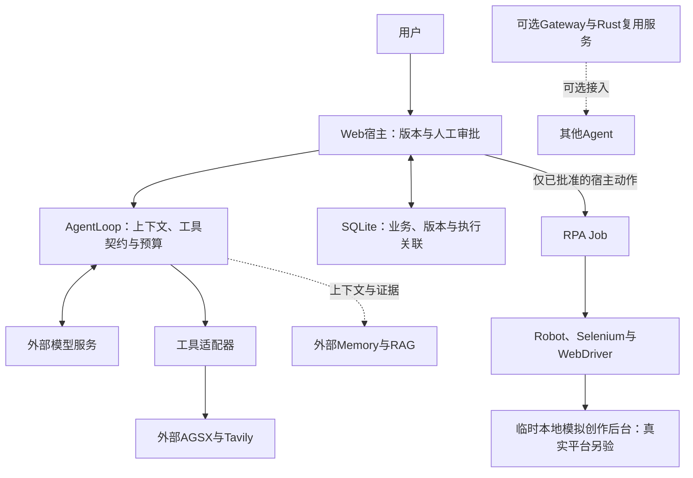

# 求职展示验收

这份材料展示自研 Agent 运行时如何把模型输出接到一个有版本、审批和恢复要求的业务流程。
核心案例是小红书内容运营：目标确认 → 研究回执 → 周计划 → 单条图文 → 图片版本审核 →
保存草稿 → 查询原任务。当前默认部署仍是本机单进程 Python Agent 与 FastAPI/SQLite。

本文件为2026-11-06本地验收封板、Git操作前快照。本轮基线为 `b5a970dbbe66225fab63f4e4c2c0bd6911e67bc0`；
预定 PR 为 `codex/job-demo-acceptance` → `codex/personal-agent-monorepo`。
本轮增量与 `main` 累计约 299 条路径是两个批次，不能用后者扩大本轮归属或发布范围。
[源码快照](job-demo-evidence/2026-11-06/source-manifest.json)绑定本次封板文件，不等于已发布版本。
快照阶段的Git操作尚待授权；后续发布、PR与CI结果请以[仓库PR](https://github.com/DongRuibo/TestAgent/pulls)和[Actions](https://github.com/DongRuibo/TestAgent/actions)核验。

项目负责人已于2026-11-06在本会话声明拥有Generation UI完整权利并允许本项目公开展示和分发。
包元数据仍为 `UNLICENSED`，不据此添加通用开源许可证或推定其他项目再许可；
授权范围与随wheel保留的第三方原文见[第三方通知](../THIRD_PARTY_NOTICES.md)。

## 本人维护的模块与外部组件

| 层 | 本人维护的实现 | 使用的外部组件及边界 |
|---|---|---|
| Agent 运行时 | `agent/loop.py`、`context.py`：工具契约、预算、去重、完整消息组、上下文裁剪和执行回执 | 模型 SDK 与模型服务完成推理；字符估算不是精确 token 计数 |
| 内容业务宿主 | `web_agent/content_workflow.py`、`weekly_planning.py`、`content_production.py`：计划绑定、版本审核、执行意图和对账 | 研究数据提供者、独立 Memory/RAG 服务分别提供外部数据与存储 |
| 工具与 UI 桥接 | `tools/` 适配器、可信 Action 参数、Web API、业务卡片及图片上传 | FastAPI、Vue、PrimeVue；Generation UI为本项目复用渲染组件，本轮实现桥接与业务卡片，未在本轮实现组件引擎，不推断既往作者身份 |
| 本地草稿执行 | RPA 模块的受控输入、Job 持久化、Robot 工作流及字段读回核验 | Robot Framework、rpaframework、Selenium、Chrome/ChromeDriver；不承诺真实平台兼容性 |
| 评测与交付 | 固定用例、评分器反例、源码/工件哈希、CI 与证据口径 | pytest、Node test、Vite、Cargo、Docker 与 GitHub Actions |

Sandbox Gateway、Rust Web Capability 与 SDK 仍保留供其他 Agent 接入；默认 Code/Browser
工具在 Agent 进程直连 AGSX/E2B，搜索直连 Tavily，不要求启动本仓库的两个服务。
[模块化架构](模块化架构与发布设计.md)、[Sandbox 接入](Sandbox_模块下载与接入指南.md)、
[Web Search 接入](Web_Search_模块下载与接入指南.md)及[其他工具演示](../README.md#agent-工具演示)继续保留。



模型没有绕过宿主审批直接启动RPA的路径。RPA另有独立 `jobs.db`，不与Web业务库组成一个事务；
Gateway/Rust供可选复用，不是默认直连能力的必经层。

## 如何判断完成

1. 模型调用候选保存工具后，才形成带来源和版本的正式候选；聊天声称完成不算保存。
2. 用户批准绑定正文版本和图片哈希；编辑正文、替换图片后必须重新审核。
3. 宿主先持久化执行意图，再由原 `on_job_created` 关联真实 Job；不确定结果先查原任务。
4. 机器成功要求重新打开草稿并读回标题、正文、标签文字、图片数量。图片内容和平台原生话题未核验。
5. 未登录或验证码可使 Job 为 `needs_user_action`、业务为 `needs_review`；正确拒绝属于正确状态。
   人工确认草稿存在另记 `manually_confirmed`，不会升级成机器完整核验成功。

外部平台与本地数据库没有同一事务，当前实现不声称 Exactly Once，也未引入分布式任务队列。

## 离线安装、启动和验收

以下命令在已有 Python 3.11/3.12、uv 和依赖缓存的干净 checkout 中执行；缓存缺失会停止，不转为下载。
本轮临时候选复用其他 checkout 的解释器时，应使用 Robot 启动器生成的显式候选 `PYTHONPATH`，
并检查 source manifest，防止 editable 包误指向旧源码。

```bash
uv sync --locked --offline
PYTHON_DOTENV_DISABLED=1 PYTHONDONTWRITEBYTECODE=1 \
  .venv/bin/python -B -m pytest -p no:cacheprovider tests packages/rpa-agent-module/tests \
  --junitxml=artifacts/job-demo/pytest.xml
PYTHON_DOTENV_DISABLED=1 PYTHONDONTWRITEBYTECODE=1 \
  .venv/bin/python -B -m evals.content_runner
PYTHON_DOTENV_DISABLED=1 PYTHONDONTWRITEBYTECODE=1 \
  .venv/bin/python -B -m evals.agent_runner --mode scripted
```

前端已有依赖时运行 `npm test`；需要安装时仅执行 `npm ci --offline --ignore-scripts`，
缺缓存就停止。`npm run build` 会重新生成跟踪的静态资源，应在干净候选中检查差异。

仅启动本地空界面、不连接模型或外部能力的命令如下。它不预置已完成的业务流程；
完整合成流程由测试夹具创建，不能把空界面启动当作任务完成。

```bash
PYTHON_DOTENV_DISABLED=1 PYTHONDONTWRITEBYTECODE=1 OPENAI_API_KEY= \
MEMORY_ENABLED=false RAG_ENABLED=false MCP_ENABLED=false MCP_ENV_FILE=/dev/null \
CONVERSATION_DB_PATH=.local/job-demo.sqlite3 \
  .venv/bin/python -B -m uvicorn web_agent.app:create_app --factory --host 127.0.0.1 --port 8000
```

普通自动 CI 使用确定性替身，不读取项目 `.env`，不调用收费模型。
本地当前默认跳过旧 7 项浏览器测试及新增 11 项整链测试；实际 CI 结果以 JUnit 为准。
远程运行需要推送后才有结果，不能把 YAML 静态检查当作远程 CI 通过。

Robot 离线预检及审批拒绝验证：

```bash
.venv/bin/python -B scripts/accept_content_robot.py --mode offline \
  --python .venv/bin/python --evidence artifacts/job-demo/robot-offline-first
```

正式整链只在本地匹配驱动和浏览器/回环权限获准后显式运行；启动器不下载依赖或驱动。
禁止下载的测试 `sitecustomize` 仅阻断 RPA 下载入口和 Selenium Manager，真实执行仍使用
生产 `submit/wait`、`python -m robot`、Selenium 与用户提供的 ChromeDriver。

```bash
.venv/bin/python -B scripts/accept_content_robot.py --mode browser \
  --python .venv/bin/python --driver /absolute/path/to/chromedriver \
  --evidence artifacts/job-demo/robot-browser-first
```

真实模型入口默认 `--mode plan`；只有 `--mode live` 才可能收费，必须使用已复核且绑定同一
账本的 approval/ledger。本文不附带可直接付费的启动命令。真实模型工作已结束，不再进行第三轮。

| 批次 | 计划分母与实际结果 | 解释 |
|---|---|---|
| 基础文件工具链 | 6/6满足固定契约，其中正常5、异常1 | 仅基础`read_file`链，不代表复杂多工具自主决策 |
| 原运营批次 | 8次：失败5、未运行3 | 达原SDK尝试上限停止；原报告和分母保留 |
| 唯一集中修复复测 | 8次全部运行：`normal_completed=3`、`correct_refusal=2`、`failed=3`、`not_run=0` | 正常组3/4完成，异常组2/4正确拒绝；不能写成运营整体通过 |

Robot 已完成计划内 11 个回环模拟场景，正常连续 3 次通过。先通过 8 项，再修正未登录场景的
Robot XML `NOT RUN` 判读并完成余下 3 项；原失败/中断保留，详见[Robot摘要](job-demo-evidence/2026-11-06/robot-summary.json)。
验证范围是标题、正文、标签文字、图片数量及任务状态；不涵盖真实平台或 Chrome 全局后台网络审计。

原批100次请求（含基础13次、原运营87次）、复测110次，210次请求用量均已观测，未知用量请求0、未结预留0。
按高峰未缓存单价估算分别为2.478504元和3.156036元，合计5.634540元，未核供应商账单，未达20元金额上限。
沿用同一账本及原始开始时间，一次配额修订将请求上限100→300、时限1800→3600秒，审计记录保留。
原批与复测不是受控因果A/B：输入/schema/反馈澄清、模型波动、原先未运行项及上限修订同时存在，不把改善全归因于源码。
结果与原始报告哈希见[真实模型最终摘要](job-demo-evidence/2026-11-06/real-model-summary.json)；[原批摘要](job-demo-evidence/2026-11-06/live-original-summary.json)继续保留。
逐次估算可由[210条去敏用量账本](job-demo-evidence/2026-11-06/model-usage-ledger.json)独立复算：2,282,146输入token、133,781计费输出token，价格口径和一次配额修订摘要均保留。

剩余失败有明确边界：L04第1次重复的第5次模型响应为`finish_reason=stop`，只说保存而没有调用保存工具，研究未落盘；
L01/L03第2次重复在研究已保存后，后续上下文估算41177/42457字符超过40000闸门，宿主正确停止且未继续周计划。
闸门符合预期不等于整条任务完成。独立AI语义复核完成，检查9份已存版本（7份当前待审、2份历史），标出11处待核，
包括缺来源泛化、因果及绝对化断言；这不是人类审批，人工`human_quality`仍待评分，不能宣称内容质量通过。
录屏中的批准来自合成测试操作员，真实模型的7份当前候选仍未获人工正文批准。
[11处语义问题摘要](job-demo-evidence/2026-11-06/semantic-review-summary.json)保留合成原句及来源编号，独立AI结论不代替人类批准。

最终离线全量03为930通过/18浏览器跳过（948项），源码哈希前后一致；02的926/18是新增4项CLI路径回归之前的历史。
Node PATH初轮2项环境失败保留，未覆盖为成功。前端最终24/24，三份构建静态资源与基线字节一致；
最终dev-agent/RPA包分别核对75/18份源码与候选一致，见[构建摘要](job-demo-evidence/2026-11-06/package-frontend-summary.json)。
最终合成业务CLI24/24，49轮无真实usage；任务成功率、语义、内容质量和成本评分均为空，未审批合成提交为0，不与真实模型分母或210次SDK计量合并。

## 三条演示脚本

下面三条是可复现的合成业务脚本，不调用模型服务或真实小红书。报告各写独立目录，
重演时更换目录，保留第一次失败；N02 会实际经过上游宿主保存，但模型、来源及平台均是替身。

| 路径 | 讲解及检查点 | 离线用例 |
|---|---|---|
| 正常完成 | 目标/计划已绑定 → 保存候选 → 上传图片另存版本 → 人工批准 → 任务关联 → 读回回执 → 刷新同一任务 | `N02` |
| 修改后重新审核 | 展示旧版及批准；编辑产生新版本，旧批准不可执行，新版未批准不可执行；审核新版后才能保存 | `A02 A03 N03` |
| 异常恢复 | 保存结果不明或业务写回失败；刷新/查询原 execution/Job，不创建第二次保存；人工“未保存”形成新待审版本 | `R01 R02 R03 R05 R06` |

```bash
PYTHON_DOTENV_DISABLED=1 PYTHONDONTWRITEBYTECODE=1 .venv/bin/python -B \
  -m evals.content_runner --cases N02 --output-dir artifacts/job-demo/demo-normal-first
PYTHON_DOTENV_DISABLED=1 PYTHONDONTWRITEBYTECODE=1 .venv/bin/python -B \
  -m evals.content_runner --cases A02 A03 N03 --output-dir artifacts/job-demo/demo-revision-first
PYTHON_DOTENV_DISABLED=1 PYTHONDONTWRITEBYTECODE=1 .venv/bin/python -B \
  -m evals.content_runner --cases R01 R02 R03 R05 R06 --output-dir artifacts/job-demo/demo-recovery-first
```

获准运行 UI→Robot 的录屏才点击真实静态 UI 的批准和保存；不把 Playwright 操作 DOM
直接调用 Library 的旧测试解释成 Robot 执行。现有三个离线报告也不是已录制的视频。

## 3–5 分钟讲解提纲与已录讲解成片

| 时间 | 画面与讲解 |
|---|---|
| 0:00–0:30 | README、基线与 manifest；说明运行时归属、合成来源和未执行边界 |
| 0:30–1:20 | 正常路径：计划中的一条内容、来源、候选保存回执、图片、版本批准 |
| 1:20–2:10 | 修改路径：对比两个版本；演示旧批准拒绝，批准新版后才出现执行 |
| 2:10–3:10 | 异常路径：原 Job、待核验状态、刷新对账、Job 数保持 1 |
| 3:10–4:00 | 分层报告、真实/合成标识、210次已观测用量与非账单估算；说明人工审批、真实平台及远程CI未验边界 |
| 4:00–5:00 | 展示已完成的Robot输出及读回差异，说明本项目组件分发授权与UNLICENSED元数据边界，结束于证据索引 |

录屏避开密钥、个人 Profile、真实账号、原始对话和客户素材。[两段原始片段](job-demo-evidence/2026-11-06/clips/README.md)已实际录制，
分别28.28秒和28.16秒，均1280×720；2项录制样本通过，原始WebM未剪辑转码，合计56.44秒，不是完整3–5分钟讲解成片。
第一段展示正常保存及添加图片另存版本后审核，第二段展示真实SQLite写回失败后查询原Job恢复；没有为录制重跑全矩阵或模型。
片段仅记录合成FastAPI UI，标记 `model=synthetic/source=synthetic/platform=loopback`；Robot过程由配对Job/XML证明，未录RPA Chrome窗口或整个桌面。
默认关闭的 `--record-video` 及缺编码器时预检停止保持不变；已按用户授权准备临时编码器，并经入口复审后执行上述两个样本。

另交付[182.12秒中文讲解成片](job-demo-evidence/2026-11-06/clips/narrated-demo.webm)，1280×720，内含原始两段的1倍速完整回放及主线、版本审批、报告和限制说明。
它是一次性本地讲解页面的录制，不是一段连续真实业务执行；没有新增Robot、模型调用或产品页面。
恢复HTTP500不由回放画面单独证明，仍需配对断言与原Job/XML回执。原始两段保持原字节、可单独下载；成片已获Independent AI Reviewer抽帧限定接受，不是人类审核或真人旁白。
本地验收已封板，模型质量限制保留；人工质量评分和Git/远程CI等未完成范围见[证据索引](job-demo-evidence/2026-11-06/README.md)。
