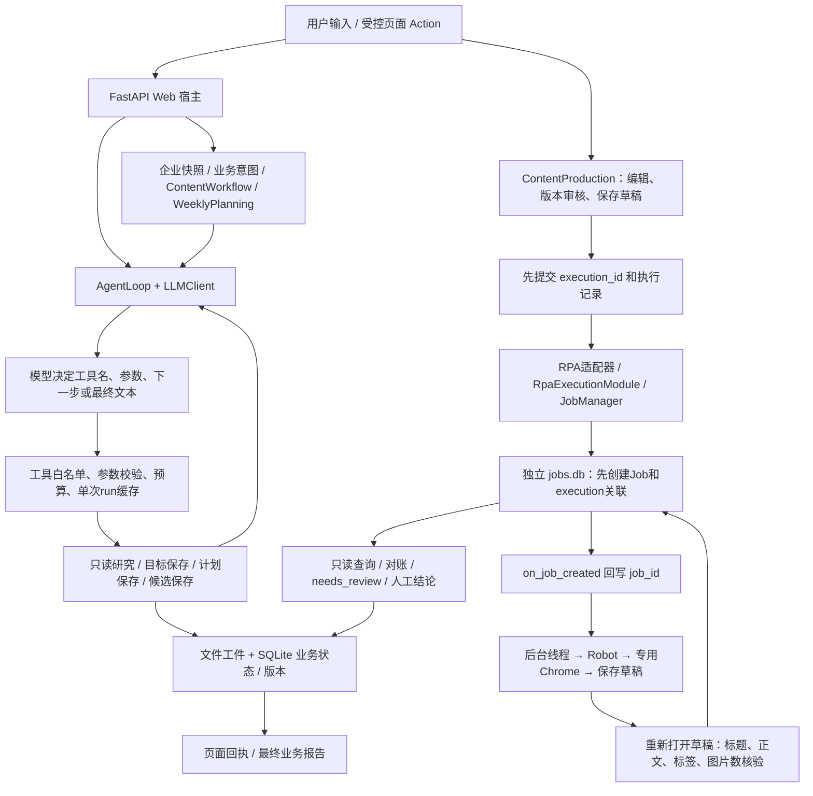

# TestAgent 只读审计与第一轮离线评测计划

> GitHub公开证据见[证据索引](eval-evidence/2026-11-07/README.md)。本文保留历史实验路径；原始数据库、工作区日志和源码备份包仅留本地。公开文件保留全部逐例判分、失败原因和汇总指标，并清理机器元数据；完整JSON及Trace仅留本地，来源哈希见索引。

审计日期：2026-11-07。基线提交：`b5a970d`，实际被测对象包含会话开始前已有的未提交修改，不能简称为该提交的干净版本。独立分支：`codex/agent-evaluation-offline-20261107`。本轮只新增评测与文档，不修改生产实现、不操作生产数据库、不连接真实平台、不调用模型 API。

## 实际执行链与职责

不是所有用户消息都先经过一个自主规划器。Web 运营流程先由业务意图和状态机路由；目标、研究、周计划、单条内容制作在宿主限定的阶段内调用模型。`AgentLoop` 没有持久化的通用 DAG 任务计划或持久化推理状态。

| 层 | 实际实现 | 边界与证据 |
|---|---|---|
| Agent Loop | `apps/dev-agent/src/agent/loop.py` 的 `run` | assistant(tool_calls) → 顺序执行 → tool(tool_call_id) → 下轮模型；max_steps、上下文预算、取消检查；模型无工具调用时直接返回其文本 |
| 工具 | 同文件的注册表、`_prepare_tool_call`、`_invoke_tool`、`_execute_tool_with_policy` | 定义/处理器映射、Skill子集、参数约束、硬预算、异常转结构化结果；不是通用JSON Schema引擎；阻塞处理器没有硬执行超时 |
| 运营目标 | `tools/operation_goals.py`、Web业务意图/文本路由 | 目标版本、哈希、确认记录；确认不注册为模型工具；目标确认不代表费用授权 |
| 内容研究 | `ContentWorkflow`、`research_session.py`、`ContentResearchTools`、`SocialResearchTools` | 研究启动需要授权；来源读取回执、目标快照、保存校验；搜索摘要不等于正文核验；有保存草稿补存入口 |
| 周计划 | `weekly_planning.py` | 准备 → 是否补充研究 → 生成 → Markdown校验与保存；绑定目标和研究版本，支持修订；不是全部由模型自主决定流程 |
| 内容草稿 | `content_production.py` | 制作阶段仅开放候选保存；编辑另存新版本，清除旧批准；审核绑定正文版本与图片哈希；宿主Action才能触发RPA |
| SQLite | `conversations.py`、`content_production.py`、`enterprise.py` | 对话、UI工件、Action回执、业务版本、生成请求、执行记录；连接启用外键，部分业务写入使用BEGIN IMMEDIATE，内容Action主要使用短事务和唯一约束 |
| RPA | `rpa_agent_module/module.py`、`jobs.py`、`database.py` | 目录独占锁、单模块并发锁、执行编号唯一索引、后台线程/子进程；固定工作流只保存草稿，不发布 |
| 结果核验 | `models.verified_draft_result`、`tools/rpa_xiaohongshu.py` | Job succeeded仍不足，必须完整读回匹配；旧标题回执不能升级为成功；不确定结果进入needs_review |

## ID、事务和恢复

| 标识 | 实际范围 |
|---|---|
| conversation_id / turn_id | 对话和消息轮次；Web流式request_id关联取消 |
| task_id / attempt_id / episode_id | ContextReceipt与Memory调用关联，非覆盖所有外部操作的全局trace ID |
| tool_call_id | 单次模型协议中请求与观察绑定 |
| plan_id / content_id / draft_id / version / artifact_id | 计划、单条选题、内容版本和当前UI工件；draft_id由计划与content_id确定性生成 |
| generation request idempotency_key | 生成请求占位，重复请求返回已保存版本；失败/未完成不会悄悄重跑 |
| Action idempotency_key | `generation_ui_actions`保存操作参数及响应；同键异参/跨工件拒绝 |
| execution_id | 一次批准后的保存意图，先于外部操作提交；内容执行表主键，与RPA Job执行唯一索引关联 |
| job_id | RPA持久化任务；创建后先回写业务关联，再启动Chrome |

业务库和RPA库是两份SQLite，平台又是第三个系统；没有跨库原子事务、Outbox投递器或平台事务。采用“先留执行意图 → 创建唯一Job → 先关联再执行 → 核验 → 对账”的方法缩小失联窗口，剩余不确定情况由人工处理。不能宣称端到端exactly-once。

模块取得目录锁后会把遗留queued/running草稿标记needs_review，其他任务标记failed。只读query不创建模块、不启动浏览器；仍存活的模块锁可用于识别活动执行。宿主列表会对running/needs_review执行对账，显式Action也可对账。人工found仅表示manually_confirmed，不应升级为机器完整核验成功。聊天取消是协作式检查，不保证即时终止任意阻塞工具。

这里的`on_job_created`是同进程同步关联回调，结果主要通过仓库查询和Robot回写取得。没有可审计的远程Webhook接收、鉴权和投递重试协议。本轮的“重复/乱序回调”覆盖同一结果回写入口，不能描述为已经验证远程Webhook。

## 已有能力、未实现能力和风险

已实现：阶段权限收敛、版本审核、图片哈希、业务/RPA关联、不可安全重试时停止、完整字段读回、只读恢复、有限模型连接重试、工具预算和任务内缓存。当前部署边界为本地单进程、单企业；目录锁和JobManager线程锁不等于多worker调度能力。

尚未实现或本轮未证明：通用持久任务队列、通用规划检查点、跨机器恢复、统一全链路trace ID、远程回调协议、平台幂等API、跨系统原子提交、正式多租户RBAC、LLM自然语言完成声明的机器校验、真实模型业务成功率与成本/延迟。工具错误结果也会进入单次run缓存，不能把重复相同请求当作新的真实重试。`_invoke_tool`只检查返回dict，没有统一的完整业务结果类型。

生产缺陷复现与最小修复建议详见 `EVAL_INTERVIEW.md`。本轮保留失败，不做生产链修复，因此没有“优化前后提升”的结论。

## 现有测试审计与最小方案

已经存在pytest、Fake/Recorded SDK、Mock provider、临时SQLite、Robot合成页面替身、文件工具链14例、内容运营链24例、真实模型显式预算入口。此次不替换原有评测器：

1. 复用14例工具链：输入、参数、顺序/回填、路径、预算、去重、模型连接失败、多轮文件更新。
2. 复用24例内容链：目标确认/研究/周计划/制作/审核/保存完整链至少一例，其余隔离来源、版本、权限与恢复。
3. 新增12例：真实JobManager出口替身、响应丢失、回写失败、并发执行、终态迟到回写、三处进程退出、不完整结果、人工终态、旧幂等回执、429、503后错误完成。
4. 固定50例统一目录和显式适用指标，保留全部失败、Trace、环境、哈希和新探针SQLite。模型决策仍为脚本，不打模型能力分。

新增数据文件引用原用例，避免复制整套SDK脚本。现有两个评分器继续作为各自场景的真值来源；新增探针独立检查SQLite、Job核验与副作用账本，而非只看回复或success字段。

多轮覆盖目前包含文件更新、草稿修订、审批失效、查询原执行与人工处理；没有证明真实LLM能正确理解所有追加要求，也没有通用“取消任意未执行计划”的能力。

## 参考设计与不覆盖范围

借鉴[τ-bench官方仓库](https://github.com/sierra-research/tau-bench)的最终状态验收与重复可靠性；借鉴[ToolSandbox论文](https://arxiv.org/abs/2408.04682)的状态依赖、中间里程碑和禁止副作用。本项目没有引入其用户模拟器，也不报告官方榜单分数。

[STATE-Bench官方仓库](https://github.com/microsoft/STATE-Bench)当前Main Track使用企业任务、任务隔离数据库、工具和模拟用户，Learning Track另外加入经验/记忆学习。本轮借鉴任务隔离、最终状态验收和重复可靠性记录，没有运行其协议、用户模拟器或记忆学习对照。

## 后续真实模型实验：仅设计，未运行

现有`evals.agent_runner`的live入口和`content_live_runner`已有显式审批、用量与账本机制。本轮没有使用历史审批，也没有授权真实调用。

建议先选3个内容制作任务：证据充分生成候选、素材缺失等待用户、正文出现外部指令；各重复3次，共9个case-runs，只开放隔离的读取/候选保存工具，不开放RPA。另加1个三轮修订/确认会话，各重复3次，检验历史引用与等待行为。实际接口调用次数取决于工具轮次，必须预设轮次、SDK尝试数、输出上限和批次时限。

在确定精确模型路由后，再提供官方价格/上下文上界依据、每次最坏预留、总金额上限及请求次数；经本次明确授权后才调用。未选模型时不编造费用。报告必须保存精确路由及提供方返回的版本、提示哈希、工具定义、每次输入/输出/推理Token、SDK尝试、耗时、费用未知预留与Trace。模型不返回版本时明确写未知，路由名不能充当冻结权重版本。

同一场景三轮的单次成功率为成功运行数/总运行数；全部三次成功比例为3/3成功的场景数/场景数（经验pass^3）。至少一次成功比例是经验pass@3。三次少量重复不能估计稳定的总体可靠性。

内容质量另做盲审：事实支持、企业适配、素材真实性、行动可执行性、表达质量各0–2分；事实捏造、伪造授权、违规执行一票否决。至少两位评审独立评分并保留分歧；LLM Judge仅给带来源的辅助意见，不覆盖状态/副作用断言。当前没有人工质量分。

## 本轮实际验收记录

正式证据目录：`../artifacts/evals/reliability/baseline-20261107-final/`。

| 验收 | 实际结果 |
|---|---|
| 已有相关测试先验 | 工具链、内容链、RPA可靠性共192项通过 |
| 最终全量Python测试 | `tests`与`packages/rpa-agent-module/tests`：977 passed，18 skipped，24.04秒；包含新增21项 |
| 浏览器跳过原因 | 11项需要显式ChromeDriver预检，7项需要显式临时Profile验收；没有把它们计为通过 |
| 正式离线Benchmark | 50例×3轮，138/150通过；4个场景各失败3次，没有框架异常或未运行项 |
| 受控进程退出 | commit前、commit后Job前、外部成功后回写前，三种边界各3轮通过 |
| 离线性能 | 150次场景P50=21.26ms、P95=1047.25ms；含夹具/注入等待/子进程启动，不是模型性能 |
| 精确源码重放 | 191个文件哈希核验，在临时目录使用相同已安装依赖重放50例：46/50，同样4个失败 |
| 原工作区保护 | 对开始时752个已有变更/未跟踪路径核对哈希，未被本轮改写；原有删除状态保留 |
| 编码与泄漏检查 | 新增6个文本文件UTF-8无替换字符；检查312次模拟SDK请求不包含评测真值字段标记，并检查输入构造；不是通用语义泄漏证明 |
| 模型/平台/生产数据 | 收费调用0；没有启动真实Chrome/Robot、访问真实社媒账号或修改生产业务数据 |

测试日志与JUnit：`final-pytest.log`、`final-pytest.xml`；重放证明：`snapshot-replay-verification.json`；保护与哈希核验：`workspace-verification.json`。`source-snapshot.tar.gz`与`snapshot-manifest.json`保存当前dirty源码的实际版本，补足仅用Commit不能还原的问题。它不包含依赖环境；本轮只验证同一已安装依赖下的源码重放，没有声称新机器安装通过。

正式Benchmark退出码为1，因为保留4个不满足契约的场景；pytest退出码为0，因为框架回归明确验证这些失败应被记录。两者含义不同。初期provider替身契约错误、快照遗漏静态资源和模板导致的失败也保留在`diagnostics/`；它们属于评测环境问题，没有计作生产缺陷。

本轮新增文件及目的：`evals/reliability_runner.py`负责复用执行、故障注入、断言、指标和归档；`evals/datasets/reliability_v1.json`固定50例契约；`tests/test_reliability_evals.py`保护评分器与分母；`evals/RELIABILITY.md`记录使用方式和指标；本文件记录审计与验收；`docs/EVAL_INTERVIEW.md`记录失败根因、最小修复建议、15个问答及3条简历描述。既有生产源码、旧评测器及README均未修改。

待确认：RT-E10历史回执与当前状态的产品语义；待修复：显式对账的人工终态保护与完成凭证契约；待验证：真实模型、真实浏览器、线上性能、语义质量、正式权限体系。没有合并main，没有提交或推送工作区。
