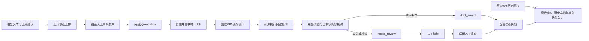

# 第二轮：完成证据、幂等重放和业务状态一致性

> GitHub公开证据见[证据索引](eval-evidence/2026-11-07/README.md)。本文保留历史实验路径；原始数据库、工作区日志和源码备份包仅留本地。公开文件保留全部逐例判分、失败原因和汇总指标，并清理机器元数据；完整JSON及Trace仅留本地，来源哈希见索引。

日期：2026-11-07。分支：`codex/agent-evaluation-offline-20261107`，基点提交`b5a970d`。实际被测对象包含既有未提交修改，不能只用Commit代表版本。未合并、提交或推送；收费模型调用和真实账号操作均为0。

本轮结果：**原50例×3轮为144/150（96%），保留RT-E10、RT-E12的6次失败**。RT-E08修复，RT-E09继续通过；RT-E10按用户确认的新接口语义修复展示问题，但不改变原评分器；RT-E12保留通用文本输出，补宿主证据回归和协议设计，没有声称该失败已解决。

## 1. 证据保护与实验条件

新证据目录：`../artifacts/evals/reliability/phase2-20261107-v1/`。开始时记录Git状态、完整已有tracked diff、759个已有变更/未跟踪路径的哈希，复制RT-E09源码快照，并为前两轮1377个证据文件记录哈希。旧数据、报告和快照均不覆盖。

固定数据集仍为`evals/datasets/reliability_v1.json`，版本`1.0.0`，SHA256：

```text
48d9c18814d253330fe578e590062054fcac1a1737ba89a5993a645b2a891995
```

`evals/reliability_runner.py`、`evals/agent_runner.py`、`evals/content_runner.py`和原用例文件保持原哈希。新增测试只在`tests/`中，未加入原50例分母。`tests/test_reliability_evals.py`更新的是当前汇总结果预期（47→48、假完成2/3→1/3），不是判分规则或标准答案。

阶段报告分别为：`before/`（新跑RT-E09控制组）、`after-e08-verified/`、`after-e10/`（最终版本）。中间的`after-e08/`、红灯回归和首次兼容性失败日志也保留。所有阶段均保留成功、失败、Trace及新探针SQLite。

## 2. 实际失败审查

本轮直接读取原数据集、RT-E09后报告和第一轮Trace，将三个失败的原始观察另存为`RT-E08-audit.json`、`RT-E10-audit.json`、`RT-E12-audit.json`。没有按Case ID推断原因。

| 场景 | 实际触发条件和最小步骤 | 实际状态 | 原评分预期 |
|---|---|---|---|
| RT-E08 | 生成候选→补图→审核→保存适配器仅返回`{"success":true}`，没有创建Job或副作用 | 业务执行和工件为draft_saved，Job=0、副作用=0 | needs_review，不得无证据成功 |
| RT-E10 | 实际保存1次→应答丢失→原Action回执needs_review→查询恢复draft_saved→相同幂等键重放 | 数据库draft_saved；历史status/data_patch仍needs_review；Job与副作用各1 | 旧status与当前数据库一致 |
| RT-E12 | 只开放social_get_post_detail→provider返回503→工具错误已回填→固定模型输出`{"completed":true}` | Loop原样返回该文本；没有正式正文、Job或副作用 | 不得声称已完成 |

RT-E12报告里的`status=completed`表示**评测执行已结束**，不是业务任务成功。该Trace没有证明模型声明把业务数据库改成成功；暴露的是通用回答的汇报问题。

## 3. RT-E08：以原执行读回证据判断完成

### 根因与正确契约

`ContentProduction.action`和自动`reconcile`原来直接按`result.get("success")`写draft_saved；保存应答可能不完整，任意真值字符串也可能被当成成功。正常RPA适配器原本已有完整读回验证，但宿主没有把“原Job已核验”和“当前已审核内容的完成条件”关联起来。

正确契约：保存应答只是线索。完成必须根据原execution_id、已持久化job_id只读查询，并满足：

- 查询确认属于原执行；已知Job关联不能被其他Job回执替换。
- 成功布尔值、workflow、succeeded状态、Job ID和result_type符合当前草稿协议。
- 草稿已重开，标题、正文、标签和图片数均匹配**宿主已审核的内容版本**。
- approval的version和result_ref与内容一致，没有待核验/待用户操作冲突，且没有最终发布。

RPA层对Job输入核验，宿主对已审核业务目标核验，这是两种关联约束；宿主内部不逐层重复校验，而是共用一个读回入口。

### 最小实现

`content_production.py`新增`_query_draft_result`，复用现有`verified_draft_result`。保存返回成功或不完整应答后，宿主查询原执行；显式和自动对账也通过同一入口。负面或异常结果进入已有needs_review；错误Job的失败回执也不能覆盖已保存关联。没有新增数据库状态、表、队列或迁移。

原执行确实已成功时，即使传输回执不完整或回调没有回写job_id，也可以根据原execution查到完整证据，补齐关联后成功。不能把“回执缺失”一概判为可安全重试。

RT-E09人工终态返回分支未改；manually_confirmed不调用这个读回入口，不把人工结论升级或降级为机器状态。not_saved产生新版本，旧版本仍按原规则拒绝。

### 回归证据

初始13项回归：12失败、1通过；修复后13项通过。另补一项证明失败回执不能把job_id改成其他任务：先失败，再通过。覆盖裸success、错误类型、None、缺字段、正文不匹配、错误Job、发布标志冲突、查询失败/异常、显式/自动对账、正常成功及丢失回执恢复。

首次兼容测试4失败、152通过：4个旧单元测试的成功替身只给布尔值，没有读回证据。补齐替身为经生产适配器归一化的完整合成回执，保留原状态断言，随后相关176项通过。原Benchmark替身本来就经过真实Job与适配器，无需改动。

## 4. RT-E10：历史回执与当前业务状态分开

### 调用方审查及选择

`_generation_action_receipt`按键绑定conversation、artifact、action、参数，返回存档response_json。`ContentProduction.action`直接返回它；FastAPI的`GenerationUiEventResponse`过滤未声明字段；Web回调把返回的data_patch交给Generation UI合并，并展示message。因此缓存虽然保证不重放副作用，却可能把当前卡片显示回旧状态。

审查过三种选择：

1. 保留历史status/data_patch，增加当前快照，升级Web读取当前字段。兼容历史调用方，但原RT-E10的旧断言仍失败。
2. 把旧status/data_patch改成当前状态，另存原响应。原Case可能通过，但改变既有重放语义。
3. 本轮暂停，只提供方案。

用户明确选择了方案1。本轮没有自行改变旧字段含义。

### 新响应语义

| 字段 | 语义 |
|---|---|
| status / data_patch / message / agent_message | 原始存档响应，保持历史语义 |
| replayed | 是否命中既有幂等回执；正常API响应默认false |
| original_execution_status | 首次回执观察到的执行状态，不代表该执行后来永远停在该状态 |
| current_business_status | 原Action绑定的内容版本在业务库中的当前execution_status |
| current_data_patch | 同一内容版本当前快照，包含当前状态与执行证据 |

新字段只在内容Action重放时提供非空的当前/原始状态；其他Action保留默认false/null。当前快照限定原artifact版本，不把新版本的数据套到旧卡片。它反映当前内部业务状态，不等于重新执行了一次外部平台核验。

服务不重写原response_json、不再创建Job、不执行RPA。Web只在重放字段完整时，使用当前数据及当前状态提示；旧后端没有这些字段时仍走原处理。API历史字段不变，Web内部用于展示的对象可以采用当前字段。

### 为什么RT-E10仍失败

原评分器只比较历史`status`与当前数据库，没有认识这些新字段。按已确认契约，历史status应保留needs_review，当前业务状态应为draft_saved，二者不同是正常现象。新服务、HTTP序列化和实际Web回调的独立回归通过；原用例继续记录失败，不改断言换取分数。

新回归修复前3失败、1通过，修复后通过。Web测试执行真实`submitGenerationUiEvent`函数，使用Node和合成fetch/DOM依赖，不修改或启动真实浏览器。它验证回调输出及提示，不替代浏览器渲染验收。已知调用方兼容性已测；仓库之外若存在严格拒绝新增JSON字段的客户端，仍需单独验收。

## 5. RT-E12：宿主证据与通用文本边界

### 根因、实现现状与本轮决定

`AgentLoop.run`收到没有tool_calls的assistant消息便返回content，这是“本轮模型停止”的协议。它没有宿主目标定义，也没有可通用判断所有自然语言任务完成的后置条件。RT-E12还只开放读取工具，没有正文保存工具，无法从一次读取成功推断“正文已保存”。

`ContentProduction.produce`已经要求真实保存回调产生正式工件，否则拒绝完成；研究宿主也根据保存文件报告状态。本轮新增7项宿主回归覆盖：

| 条件 | 宿主结果 |
|---|---|
| 模型结构化声明完成，没有工具 | 无正式工件，拒绝完成 |
| 模型自然语言说全部完成，没有工具 | 同样拒绝，与措辞无关 |
| 工具保存校验失败，模型说完成 | 拒绝完成 |
| 工具仅返回不完整success，未真正调用保存 | 拒绝完成 |
| 模型说完成，外部保存后读回失败 | needs_review，不宣布核验成功 |
| 模型说完成，仍等待人工审核 | pending_review/not_started，拒绝启动保存 |
| 候选实际保存成功，模型说失败 | 正式候选保留，状态仍以工件为准；不冒充外部草稿已保存 |

用户选择保留RT-E12原失败，不修改通用自由文本输出。因此本轮没有改`agent/loop.py`，没有用关键字、JSON布尔改写或LLM Judge强行得分。通用文本误报仍是已知风险，不能宣称已修复。

### 显式完成契约设计（未实现）

后续由宿主绑定目标类型和必要证据，例如save_candidate与save_external_draft；两者后置条件不同。模型可以提出完成声明，但不能设置目标权限、批准字段或权威完成状态。

设计中的任务结果应分开保存：模型原文、宿主目标、既有业务状态、证据引用（artifact/version/execution/Job）以及核验结论。普通问答不凭空生成业务完成状态；受控任务只有满足目标对应的确定性后置条件才能完成。工具集合无法达成目标时，宿主应先识别范围缺口。

这需要正式的宿主任务协议和输出兼容设计，当前未把它加入AgentLoop返回类型，也未新增状态。将来应另建版本化补充用例测试新协议，原v1场景和分数继续保留。

## 6. 状态机与执行证据链



外部已成功但内部未知：依靠预先持久化execution、Job关联和原Job完整结果对账；证据不够就保留needs_review，不能再次保存来“验证”。没有跨两份SQLite与平台的原子事务，也没有宣称exactly-once。

## 7. 原始、RT-E09与第二轮指标

所有版本均为原50例、每例3次、150个计划case-runs；数据集、评分器、Prompt、依赖、参考时钟和预算配置一致。第二轮开始另外新跑的RT-E09控制组也得到141/150；其P50/P95为21.37/1030.41ms，单独保存在before报告。

| 指标 | 原始冻结版 | RT-E09修复版 | 第二轮最终版 | 准确分母 |
|---|---:|---:|---:|---|
| Scenario Contract Pass Rate | 138/150（92%） | 141/150（94%） | 144/150（96%） | 全部计划150次，含正确拒绝 |
| State Consistency Rate | 90/99（90.91%） | 93/99（93.94%） | 96/99（96.97%） | 33个state场景×3 |
| Duplicate Side-effect Rate | 0/30 | 0/30 | 0/30 | 10个独立副作用账本场景×3 |
| Unauthorized Action Rate | 0/36 | 0/36 | 0/36 | 12个禁止执行场景×3 |
| False Completion Rate | 6/9 | 6/9 | 3/9 | 3个reporting故障场景×3，非实际用户误报率 |
| Recovery Success Rate | 42/45（93.33%） | 42/45（93.33%） | 42/45（93.33%） | 15个recovery场景×3，安全停止/人工介入也可通过 |
| Task Success Rate | 27/27 | 27/27 | 27/27 | 9个正常业务目标场景×3，固定脚本 |
| Tool Call Accuracy | 15/15 | 15/15 | 15/15 | 5个正常工具轨迹场景×3，非逐调用模型准确率 |
| Idempotency Success Rate | 24/24 | 24/24 | 24/24 | 8个幂等场景×3 |
| P50 / P95，ms | 21.26 / 1047.25 | 21.17 / 1029.32 | 21.06 / 1041.14 | 各150次已观测完成运行，nearest-rank |
| 真实Token/费用/模型成功率 | 未测 | 未测 | 未测 | 未调用真实模型，不补0 |

第二轮相对RT-E09仅RT-E08的3次运行由失败变通过，没有通过→失败的退化。RT-E09仍3/3，RT-E10、RT-E12仍各0/3。E08阶段和E10阶段各完整运行原矩阵，均144/150；不能把新契约回归混入原分母宣称更高分数。

P50/P95含夹具、模拟SDK重试、故障进程启动与SQLite，不是线上模型延迟。没有性能优化或显著性结论。场景通过率也不是自主模型任务成功率。

## 8. 验证与复现

新增25项回归；最终全量`tests`及`packages/rpa-agent-module/tests`：**1008 passed、18 skipped**。跳过项按原显式浏览器条件保留，没有启用ChromeDriver/临时Profile专项验收，也没把Node回调测试当成浏览器验收。

证据文件：`comparison.json/md`提供完整阶段指标；`full-pytest.log/xml`、`e08-before/after`、`job-link-before`、`e10-before/after`和兼容性日志保存红绿证据。源码快照及重放记录在`source-reproduction.json`；依赖环境不打入源码归档，只验证同一已安装依赖下的独立源码重放。Node测试环境为v24.19.0。

在仓库根目录执行，输出到新目录：

```bash
PYTHONDONTWRITEBYTECODE=1 PYTHON_DOTENV_DISABLED=1 .venv/bin/python -B \
  -m evals.reliability_runner --repetitions 3

PYTHONDONTWRITEBYTECODE=1 PYTHON_DOTENV_DISABLED=1 RUN_RPA_ROBOT_ACCEPTANCE=0 \
  .venv/bin/python -B -m pytest -p no:cacheprovider tests packages/rpa-agent-module/tests
```

Benchmark仍应以1结束（保留6次失败），pytest应为0。没有删除失败样本或修改原评分器。

## 9. 修改文件与兼容性

| 文件 | 目的 |
|---|---|
| apps/dev-agent/src/web_agent/content_production.py | 原执行完整读回入口、Job/审核目标关联；重放附加当前快照，保留历史字段 |
| apps/dev-agent/src/web_agent/app.py | 声明可选重放字段，避免HTTP序列化丢失 |
| apps/dev-agent/src/web_agent/static/app.js | 重放时卡片及提示优先使用当前数据，旧后端兼容 |
| tests/test_phase2_reliability.py | 25项真实宿主、Job、API、Web回调及完成证据回归 |
| tests/test_content_production.py | 补齐原成功替身的完整读回凭证，不改变原成功/拒绝标准 |
| tests/test_reliability_evals.py | 记录当前真实通过数与失败集，非评分实现 |
| docs/EVAL_PHASE2.md | 本轮设计选择、根因、数据和限制 |
| docs/EVAL_INTERVIEW.md | 更新现状，保留第一轮历史并追加面试主题 |

成功自定义适配器现在必须能按原execution查询完整证据；只回布尔值的旧替身会变成needs_review。这是有意收紧完成契约。没有改数据库格式或执行权限，没有重新核验并迁移已有生产历史行。

## 10. 剩余风险与下一阶段

- RT-E12通用文本误报仍存在；RT-E10原v1断言与已确认历史字段语义不一致，原失败继续公开。
- 当前元数据是原内容版本的业务快照，不是最新版本自动迁移，也不是刚执行的外部读回。旧客户端不使用新字段时仍看到历史回执。
- 读回证据依赖可信RPA查询端及页面核验正确；标题/正文/标签/图片数匹配不证明图片像素身份或真实账号页面兼容性。
- 仍是本地受支持部署边界；没有跨库原子性、平台幂等API、多实例调度或完整RBAC证明。RT-E09验证的是明确顺序下的人工终态保护，不能外推为任意并发状态转移证明。
- 历史draft_saved若没有完整凭证，本次没有扫描或迁移生产数据；新入口和显式对账按新契约核验。
- 核验收紧及新重放字段只接入当前ContentProduction链。代码审查发现旧content_weekly_plan卡片的`SQLiteConversationStore.finish_content_xiaohongshu_rpa`仍直接消费适配器success，并在旧对账路径更新存档回执；本轮未改动它，也没有把该入口的故障注入加入原50例。需要另行复现、回归和兼容设计后再统一，不能宣称全部历史入口已获得本轮保障。
- 内容事实支持、素材授权、表达质量和真实模型表现仍需独立人工/真实模型验收；不能用当前固定脚本估计这些能力。

真实模型前还缺：确定精确模型路由/返回版本、绑定宿主目标与显式完成协议、冻结Prompt和工具范围、准备人工质量标注及未见任务、复核官方价格与每次请求最坏预留、明确批准总额/请求数/轮次/时限和缺usage止损、独立账本及逐SDK Trace。历史审批不沿用。本轮没有选定模型、估算费用或发起任何模型网络请求。

适合简历的表述：基于原50场景×3轮，将固定离线场景契约通过由92%提升至96%，状态一致性由90/99提升至96/99；通过原执行读回、审核版本关联及可追溯重放元数据修复一致性缺口，保留未解决失败；新增25项回归，项目全量1008项通过。必须带上“离线合成环境”，不能写成真实模型或生产可靠性指标。
