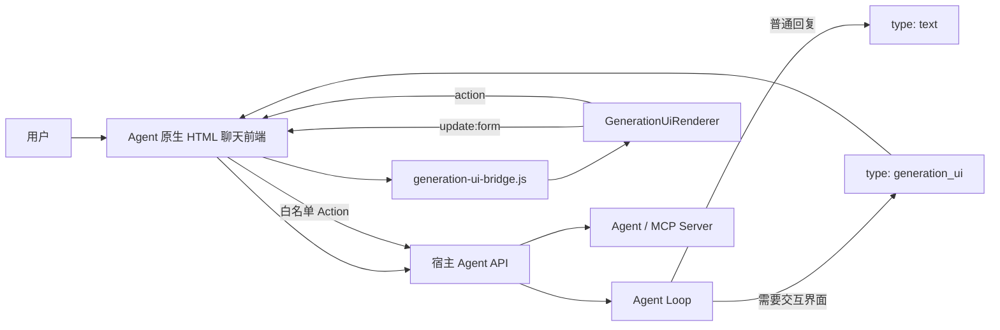

# Generation UI Vue 组件交付与原生 HTML Agent 接入指南

> 组件：`@lazyai/generation-ui-vue`
> 版本：`0.5.2`
> 交付包：`lazyai-generation-ui-vue-0.5.2.tgz`
> SHA-256：`002e8d678c5242fccc6d6ff6a6674c5e374e62ffb3f5222024c87b80476d1e14`
> 适用对象：需要把组件接入现有 Agent、原生 HTML/CSS/JavaScript 前端的开发者或 Codex

## 1. 交付目标

收到以下两个文件后，对方应该能够完成接入：

```text
lazyai-generation-ui-vue-0.5.2.tgz
组件交付与原生HTML-Agent接入指南.md
```

接入完成后，Agent 聊天页面应同时支持：

- 普通文字消息；
- Generation UI 消息；
- 一条消息中局部挂载 Vue Renderer；
- 多个 Generation UI 实例同时存在；
- 表单填写与状态恢复；
- Action 二次确认和后端转发；
- 生成失败时自然降级为文字提示；
- 组件逐个出现和重看生成过程；
- 页面切换后恢复历史 UI 和表单结果。

## 2. 先理解交付物包含什么

`lazyai-generation-ui-vue-0.5.2.tgz` 只包含：

- Vue 3 `GenerationUiRenderer`；
- 55 个受控白名单组件的渲染实现；
- TypeScript 类型声明；
- Renderer 独立样式；
- 包内 README。

它不包含：

- Agent Loop；
- 大模型调用；
- MCP Server；
- 工具实现；
- UISpec 生成服务；
- 权限和鉴权；
- 聊天页面；
- 原生 HTML Bridge；
- 固定后端地址。

因此，接入不是“安装后自动接管整个页面”，而是由宿主系统把已验证的 `UISpec + data` 交给 Renderer。

## 3. 推荐架构



推荐由 Agent 后端明确返回消息类型，不要在生产系统中只靠前端关键词判断是否生成 UI。

## 4. 接入前先让 Codex 检查项目

在修改代码前，接入方 Codex 应先确认：

1. 原生页面入口文件在哪里，例如 `index.html`。
2. 页面 JavaScript 入口在哪里，例如 `app.js`。
3. 是否已有 `package.json` 和构建工具。
4. 静态文件由 Vite、Webpack、Nginx 还是 FastAPI 提供。
5. 聊天消息的数据结构和渲染函数在哪里。
6. Agent 后端接口在哪里。
7. Agent 是否已经能返回结构化消息。
8. 会话、消息和用户鉴权方式是什么。
9. 是否存在 Content Security Policy 或严格 CSS 隔离。

如果项目完全没有前端构建工具，推荐增加 Vite，但保留现有原生 HTML 页面，不需要把整个页面改写成 Vue。

## 5. 环境要求

| 依赖 | 推荐版本 |
|---|---|
| Node.js | 20+，当前 Demo 使用 24 |
| Vue | `^3.5.0` |
| PrimeVue | `^4.5.0` |
| PrimeIcons | `^7.0.0` |
| `@primeuix/themes` | `^1.2.0` |
| Chart.js | `^4.4.0` |
| Vite | 6+ 或 7+ |

当前包为 ESM，不支持直接作为无依赖的传统 `<script src="...">` 文件使用。

## 6. 安装组件

### 6.1 复制文件

在接入方前端项目中创建：

```text
packages/
└── lazyai-generation-ui-vue-0.5.2.tgz
```

### 6.2 安装依赖

安装前先核对文件：

```bash
shasum -a 256 packages/lazyai-generation-ui-vue-0.5.2.tgz
```

结果应与文档首页的 SHA-256 相同。

```bash
npm install ./packages/lazyai-generation-ui-vue-0.5.2.tgz
npm install vue@^3.5 primevue@^4.5 primeicons@^7 @primeuix/themes@^1.2 chart.js@^4.4
npm install -D vite
```

也可以将文件依赖写进原有 `package.json`：

```json
{
  "dependencies": {
    "@lazyai/generation-ui-vue": "file:./packages/lazyai-generation-ui-vue-0.5.2.tgz"
  }
}
```

不要用示例覆盖接入方完整 `package.json`；只合并缺少的依赖和命令。

### 6.3 引入样式

前端入口只需要引入一次：

```js
import "primeicons/primeicons.css";
import "@lazyai/generation-ui-vue/style.css";
```

不要复制当前 Demo 三栏页面的全部 CSS。组件包自己的样式已经使用 `.generation-ui-renderer` 作为主要作用域。

## 7. 四类核心数据

| 名称 | 含义 | 来源 | 是否可编辑 |
|---|---|---|---:|
| `spec` | 页面结构、交互模式和 Action 定义 | Generation UI 后端 | 否 |
| `data` | 指标、表格、列表、图表等业务数据 | Agent/MCP/业务后端 | 否 |
| `form` | 用户当前填写和选择的状态 | Renderer/宿主 | 是 |
| `action` | 用户点击的受控业务意图 | Renderer 事件 | 由后端执行 |

记忆方式：

```text
spec = 页面说明书
data = 展示结果
form = 用户填写状态
action = 用户提交意图
```

## 8. 推荐消息协议

### 8.1 普通文字消息

```json
{
  "type": "text",
  "conversation_id": "conv_001",
  "message_id": "msg_001",
  "role": "assistant",
  "content": "已经为你整理了项目信息。"
}
```

### 8.2 Generation UI 消息

```json
{
  "type": "generation_ui",
  "conversation_id": "conv_001",
  "message_id": "msg_002",
  "artifact_id": "ui_001",
  "role": "assistant",
  "text": "请在界面中确认项目信息。",
  "spec": {
    "version": "0.1",
    "scenario": "project-create",
    "interaction_mode": "host_action",
    "title": "创建装修项目",
    "summary": "确认资料和地址后提交。",
    "root": {
      "id": "root",
      "type": "Column",
      "props": {},
      "children": []
    },
    "actions": [],
    "form_defaults": {}
  },
  "data": {}
}
```

### 8.3 必须保留的 ID

| ID | 用途 |
|---|---|
| `conversation_id` | 关联会话和 Agent 上下文 |
| `message_id` | 关联聊天消息 |
| `artifact_id` | 保存 UI 的 form、spec 和 data |
| `client_request_id` | 生成请求追踪和去重 |
| `idempotency_key` | 防止 Action 重复执行 |

## 9. UISpec 协议

```ts
interface UINode {
  id: string;
  type: string;
  props: Record<string, unknown>;
  children: UINode[];
}

interface UIActionDefinition {
  id: string;
  label: string;
  tool: string;
  confirm: boolean;
  tone: string;
}

interface UISpec {
  version: string;
  scenario: string;
  interaction_mode?: "read_only" | "local_preview" | "host_action";
  title: string;
  summary: string;
  root: UINode;
  actions: UIActionDefinition[];
  form_defaults: Record<string, unknown>;
}
```

交给浏览器前，后端必须完成：

- JSON/Pydantic 或 JSON Schema 校验；
- 组件类型白名单校验；
- Props 类型和长度校验；
- 节点 ID 唯一性校验；
- 组件数量和嵌套深度限制；
- `data` 路径存在性校验；
- Action ID 和工具映射校验；
- 敏感组件与交互模式校验。

不能把模型原始 JSON 不经校验直接交给 Renderer。

## 10. 三种交互模式

| 模式 | 可展示 | 可填写 | 外部 Action |
|---|---:|---:|---:|
| `read_only` | 是 | 否 | 否 |
| `local_preview` | 是 | 是 | 否 |
| `host_action` | 是 | 是 | 是 |

`PasswordInput` 和 `InputOtp` 只能用于 `local_preview`，不得预填、写日志或持久化。

## 11. 55 个白名单组件索引

### 11.1 布局和容器

| 类型 | 关键 Props | 说明 |
|---|---|---|
| `Column` | `gap?` | 纵向布局，根节点必须是 Column |
| `Row` | 无 | 响应式横向布局 |
| `Card` | `title?`, `subtitle?` | 卡片容器 |
| `Section` | `label`, `title?` | Tabs、Accordion、Sidebar 的内容分区 |
| `MetricGrid` | 无 | 指标网格 |
| `Tabs` | 无 | 子节点使用 Section |
| `Accordion` | 无 | 子节点使用 Section |
| `Divider` | 无 | 分隔线 |
| `Grid` | `columns?`, `gap?` | 1–4 列响应式网格 |
| `SplitLayout` | `ratio?` | 必须包含两个子节点 |
| `Sidebar` | `title?` | 根节点下的左侧菜单和内容切换 |
| `Stepper` | 无 | 2–8 个本地步骤 |
| `Breadcrumb` | `items` | 只读层级导航 |

### 11.2 数据展示

| 类型 | 关键 Props | 说明 |
|---|---|---|
| `Metric` | `label`, `path`, `format?`, `suffix?`, `tone?` | 单个指标 |
| `Tag` | `text?` 或 `path?`, `tone?` | 状态标签 |
| `Alert` | `path?`, `title?`, `severity?` | 提示、警告、错误 |
| `DataTable` | `path`, `columns` | 普通结构化表格 |
| `ComparisonTable` | `path`, `titleField`, `fields`, `badgeField?`, `interactive?`, `selectionModel?` | 2–4 个对象横向对比 |
| `DescriptionList` | `items` | 键值摘要 |
| `ProgressBar` | `path`, `label?` | 进度 |
| `Timeline` | `path`, `titleField`, `dateField`, `descriptionField` | 时间线 |
| `RecommendationList` | `path` | 建议列表 |
| `Text` | `text?` 或 `path?` | 普通文本 |
| `List` | `path`, `itemField?`, `secondaryField?` | 通用列表 |
| `SourceList` | `path`, `titleField?`, `urlField?` | 安全来源列表 |
| `Chart` | `path`, `type`, `labelField?`, `valueField?` | 柱状、折线、饼图、环形图 |
| `EmptyState` | `title`, `description?`, `icon?` | 空数据状态 |
| `CodeBlock` | `text?` 或 `path?`, `language?` | 只读代码，不执行 |
| `Avatar` | `label?` 或 `path?`, `shape?`, `size?` | 头像占位 |
| `SafeImage` | `path`, `alt`, `caption?` | 只接受 HTTPS 数据地址 |
| `Tree` | `path` | 树形结构 |
| `StatComparison` | `label`, `currentPath`, `previousPath` | 当前值和上一期对比 |
| `Gauge` | `path`, `label`, `min?`, `max?`, `suffix?` | 范围指标 |
| `Pagination` | `totalRecords?` 或 `path?`, `rows?` | 本地分页 |
| `Skeleton` | `rows?` | 加载占位 |

### 11.3 表单和交互

| 类型 | 关键 Props | 写入 form |
|---|---|---:|
| `Form` | `title?` | 否 |
| `TextInput` | `label`, `model`, `placeholder?`, `span?` | 是 |
| `TextArea` | `label`, `model`, `rows?`, `placeholder?` | 是 |
| `NumberInput` | `label`, `model`, `min?`, `max?`, `step?`, `maxFractionDigits?`, `format?` | 是 |
| `Select` | `label`, `model`, `options` | 是 |
| `MultiSelect` | `label`, `model`, `options` | 是 |
| `DatePicker` | `label`, `model` | 是 |
| `ActionButton` | `actionId`, `label`, `tone?` | 抛出 Action |
| `PasswordInput` | `label`, `model`, `placeholder?` | 是，仅本地预览 |
| `Checkbox` | `label`, `model` | 是 |
| `RadioGroup` | `label`, `model`, `options` | 是 |
| `ToggleSwitch` | `label`, `model` | 是 |
| `Slider` | `label`, `model`, `min?`, `max?`, `step?` | 是 |
| `Rating` | `label`, `model`, `max?` | 是 |
| `InputOtp` | `label`, `model`, `length?` | 是，仅本地预览 |
| `PreviewButton` | `label`, `help?` | 否，不执行 Action |
| `AutoComplete` | `label`, `model`, `options` | 是 |
| `InputMask` | `label`, `model`, `mask`, `placeholder?` | 是 |
| `RangeSlider` | `label`, `model`, `min?`, `max?`, `step?` | 是 |
| `ChipSelect` | `label`, `model`, `options` | 是 |

模型不能直接使用 PrimeVue 中未注册的组件。新增组件必须同时更新后端白名单、Renderer、样式、测试和组件包版本。

## 12. Vue 前端直接接入

如果对方 Agent 前端本身就是 Vue 3，直接使用：

```vue
<script setup lang="ts">
import { ref } from "vue";
import {
  GenerationUiRenderer,
  type GenerationUiActionEvent,
  type UISpec,
} from "@lazyai/generation-ui-vue";
import "@lazyai/generation-ui-vue/style.css";

const props = defineProps<{
  conversationId: string;
  messageId: string;
  artifactId: string;
  spec: UISpec;
  data: Record<string, unknown>;
}>();

const form = ref<Record<string, unknown>>({ ...props.spec.form_defaults });
const busyAction = ref<string | null>(null);

async function handleAction(event: GenerationUiActionEvent) {
  if (event.action.confirm && !window.confirm(`确认执行“${event.action.label}”吗？`)) return;
  busyAction.value = event.actionId;
  try {
    await fetch("/api/generation/action", {
      method: "POST",
      headers: { "Content-Type": "application/json" },
      body: JSON.stringify({
        artifact_id: props.artifactId,
        conversation_id: props.conversationId,
        message_id: props.messageId,
        scenario: props.spec.scenario,
        action_id: event.actionId,
        arguments: event.arguments,
        idempotency_key: crypto.randomUUID(),
      }),
    });
  } finally {
    busyAction.value = null;
  }
}
</script>

<template>
  <GenerationUiRenderer
    :spec="spec"
    :data="data"
    v-model:form="form"
    :busy-action="busyAction"
    @action="handleAction"
  />
</template>
```

宿主入口需要注册 PrimeVue：

```js
import { createApp } from "vue";
import PrimeVue from "primevue/config";
import Aura from "@primeuix/themes/aura";
import "primeicons/primeicons.css";

createApp(App)
  .use(PrimeVue, { theme: { preset: Aura } })
  .mount("#app");
```

## 13. 原生 HTML 前端接入

原生 HTML 页面保持原有 DOM 和业务逻辑，只在 Generation UI 消息中创建局部 Vue 实例。

### 13.1 新建 `generation-ui-bridge.js`

```js
import { createApp, h, reactive } from "vue";
import PrimeVue from "primevue/config";
import Aura from "@primeuix/themes/aura";
import "primeicons/primeicons.css";
import { GenerationUiRenderer } from "@lazyai/generation-ui-vue";
import "@lazyai/generation-ui-vue/style.css";

function clone(value) {
  return value == null ? value : JSON.parse(JSON.stringify(value));
}

function assertOptions(container, options) {
  if (!(container instanceof HTMLElement)) throw new Error("Generation UI 挂载节点无效");
  if (!options?.spec || options.spec.version !== "0.1") throw new Error("缺少有效的 UISpec 0.1");
  if (options.spec.root?.type !== "Column") throw new Error("UISpec root 必须是 Column");
  if (!options.data || typeof options.data !== "object") throw new Error("data 必须是对象");
}

function renderOrder(root) {
  return (root.children ?? []).flatMap((child) => [child, ...renderOrder(child)]);
}

function visibleSpec(spec, count) {
  let remaining = count;
  const reveal = (node) => {
    const next = { ...clone(node), children: [] };
    for (const child of node.children ?? []) {
      if (remaining <= 0) break;
      remaining -= 1;
      next.children.push(reveal(child));
    }
    return next;
  };
  return { ...clone(spec), root: reveal(spec.root) };
}

function wait(ms) {
  return new Promise((resolve) => window.setTimeout(resolve, ms));
}

export function mountGenerationUi(container, options) {
  assertOptions(container, options);
  let fullSpec = clone(options.spec);
  const progressive = options.progressive === true;
  const state = reactive({
    spec: progressive ? visibleSpec(fullSpec, 0) : clone(fullSpec),
    data: clone(options.data),
    form: clone(options.form ?? options.spec.form_defaults ?? {}),
    busyAction: null,
    showHeader: options.showHeader !== false,
  });

  const Root = {
    setup() {
      return () => h(GenerationUiRenderer, {
        spec: state.spec,
        data: state.data,
        form: state.form,
        busyAction: state.busyAction,
        showHeader: state.showHeader,
        "onUpdate:form": (nextForm) => {
          state.form = clone(nextForm);
          options.onFormChange?.(clone(nextForm));
        },
        onAction: async (event) => {
          if (state.busyAction) return;
          state.busyAction = event.actionId;
          try {
            await options.onAction?.(clone(event), clone(state.form));
          } finally {
            state.busyAction = null;
          }
        },
      });
    },
  };

  const app = createApp(Root);
  app.use(PrimeVue, { theme: { preset: Aura, options: { darkModeSelector: false } } });
  app.config.errorHandler = (error) => options.onError?.(error);
  app.mount(container);

  let destroyed = false;
  let playbackToken = 0;

  async function replay() {
    if (destroyed) throw new Error("Generation UI 实例已经销毁");
    const token = ++playbackToken;
    const nodes = renderOrder(fullSpec.root);
    const total = nodes.length;
    state.spec = visibleSpec(fullSpec, 0);
    options.onProgress?.({ current: 0, total, status: "running", node: null });
    for (let index = 0; index < total; index += 1) {
      await wait(Math.max(80, Number(options.progressiveDelay ?? 260)));
      if (destroyed || token !== playbackToken) return;
      state.spec = visibleSpec(fullSpec, index + 1);
      options.onProgress?.({
        current: index + 1,
        total,
        status: "running",
        node: clone(nodes[index]),
      });
    }
    state.spec = clone(fullSpec);
    options.onProgress?.({ current: total, total, status: "completed", node: null });
  }

  if (progressive) queueMicrotask(() => replay().catch((error) => options.onError?.(error)));

  return {
    update(next = {}) {
      if (destroyed) throw new Error("Generation UI 实例已经销毁");
      playbackToken += 1;
      if (next.spec) {
        fullSpec = clone(next.spec);
        state.spec = clone(fullSpec);
      }
      if (next.data) state.data = clone(next.data);
      if (next.form) state.form = clone(next.form);
    },
    replay,
    getForm() {
      return clone(state.form);
    },
    destroy() {
      if (destroyed) return;
      playbackToken += 1;
      app.unmount();
      container.replaceChildren();
      destroyed = true;
    },
  };
}
```

### 13.2 在聊天消息中挂载

```js
import { mountGenerationUi } from "./generation-ui-bridge.js";

const uiInstances = new Map();
const formByArtifact = new Map();

function mountUiMessage(message, mountPoint) {
  const savedForm = formByArtifact.get(message.artifact_id)
    ?? structuredClone(message.spec.form_defaults ?? {});

  const instance = mountGenerationUi(mountPoint, {
    spec: message.spec,
    data: message.data,
    form: savedForm,
    progressive: true,
    progressiveDelay: 220,
    onFormChange(nextForm) {
      formByArtifact.set(message.artifact_id, nextForm);
    },
    async onAction(event, form) {
      await handleUiAction(message, event, form);
    },
    onProgress(progress) {
      updateProgressUi(message.message_id, progress);
    },
    onError(error) {
      console.error("Generation UI 渲染失败", error);
    },
  });

  uiInstances.set(message.message_id, instance);
}

function destroyUiMessage(messageId) {
  uiInstances.get(messageId)?.destroy();
  uiInstances.delete(messageId);
}

function destroyAllUiMessages() {
  uiInstances.forEach((instance) => instance.destroy());
  uiInstances.clear();
}
```

消息列表整体重绘前先调用 `destroyAllUiMessages()`，否则会产生重复 Vue 实例和事件监听器。

### 13.3 创建消息 DOM

```js
function createAssistantMessage(message) {
  const article = document.createElement("article");
  article.className = `message ${message.type}`;

  if (message.type === "text") {
    const bubble = document.createElement("div");
    bubble.textContent = message.content;
    article.append(bubble);
    return article;
  }

  const replay = document.createElement("button");
  replay.type = "button";
  replay.textContent = "重看生成过程";

  const mountPoint = document.createElement("div");
  mountPoint.className = "generation-ui-mount";
  article.append(replay, mountPoint);

  queueMicrotask(() => {
    mountUiMessage(message, mountPoint);
    replay.addEventListener("click", () => uiInstances.get(message.message_id)?.replay());
  });
  return article;
}
```

### 13.4 保证聊天区域可以滚动

宿主布局至少要满足：

```css
.agent-shell {
  min-height: 0;
}

.message-list {
  min-height: 0;
  overflow-y: auto;
  overflow-x: hidden;
}

.generation-ui-mount {
  min-width: 0;
  width: 100%;
}

.composer {
  position: sticky;
  bottom: 0;
  z-index: 10;
}
```

不要给消息列表设置无法滚动的固定高度，也不要让 Generation UI 外层使用超出聊天栏宽度的固定像素宽度。

## 14. Action 接入 Agent 后端

### 14.1 浏览器提交

```js
async function handleUiAction(message, event, form) {
  if (event.action.confirm) {
    const accepted = window.confirm(`确认执行“${event.action.label}”吗？`);
    if (!accepted) return;
  }

  const response = await fetch("/api/generation/action", {
    method: "POST",
    headers: { "Content-Type": "application/json" },
    body: JSON.stringify({
      artifact_id: message.artifact_id,
      conversation_id: message.conversation_id,
      message_id: message.message_id,
      scenario: message.spec.scenario,
      action_id: event.actionId,
      arguments: form,
      idempotency_key: crypto.randomUUID(),
    }),
  });

  if (!response.ok) throw new Error("Action 执行失败");
  const result = await response.json();
  if (result.data_patch) applyPatch(message.data, result.data_patch);
  if (result.agent_message) appendTextMessage(result.agent_message);
}

function applyPatch(target, patch) {
  for (const [path, value] of Object.entries(patch)) {
    const parts = path.split(".");
    let cursor = target;
    for (const part of parts.slice(0, -1)) {
      cursor[part] ??= {};
      cursor = cursor[part];
    }
    cursor[parts.at(-1)] = value;
  }
}
```

### 14.2 Action 请求协议

```json
{
  "artifact_id": "ui_001",
  "conversation_id": "conv_001",
  "message_id": "msg_002",
  "scenario": "project-create",
  "action_id": "confirm_project",
  "arguments": {
    "city": "杭州市",
    "selectedAddress": "杭州市西湖区建设路 88 号"
  },
  "idempotency_key": "8a0d..."
}
```

### 14.3 Action 响应协议

```json
{
  "success": true,
  "message": "项目已创建。",
  "status": "completed",
  "data_patch": {
    "project.status": "已创建"
  },
  "agent_message": "项目已经创建，后续可以继续完善预算。"
}
```

### 14.4 后端安全要求

后端只能信任：

- 已认证的用户和会话；
- `action_id`；
- 服务端 Action 注册表；
- 重新校验后的 `arguments`。

后端不能直接信任：

- 浏览器提交的 `tool`；
- 浏览器提交的 `confirm`；
- 模型原始 Action 元数据；
- 前端权限判断结果。

正确顺序：

```text
action_id
→ 服务端查注册表
→ 检查用户权限
→ 校验参数
→ 高风险操作再次确认
→ Agent Loop / MCP Server
→ 返回结构化结果
```

## 15. Agent 如何决定文字还是 UI

推荐让 Agent 编排层输出明确类型：

```text
普通问答、解释、短结果 → text
需要表单、对比、看板、复杂结果、用户确认 → generation_ui
```

不要要求所有回答都生成 UI。UI 生成失败也不能阻断普通聊天。

如果当前 Agent 暂时不能输出消息类型，可以在宿主增加临时路由，但必须标记为过渡方案。关键词路由只适合 Demo。

## 16. Generation UI 服务的两种接法

### 16.1 Agent 直接返回完整消息（推荐）

Agent 后端完成数据准备、UISpec 生成和验证，然后把 `generation_ui` 消息直接返回聊天接口。

优点：

- 前端只处理一种消息流；
- 会话和权限天然一致；
- 不需要浏览器访问第二个服务；
- 更适合正式 Agent 系统。

### 16.2 独立 Generation UI 服务

如果 UISpec 生成仍是独立服务，浏览器应通过宿主后端代理：

```text
浏览器 /api/generation/generate
→ 宿主 FastAPI
→ 内网 Generation UI 服务
```

不要让浏览器直接持有模型 Key，也不要把内网服务地址写入组件包。

FastAPI 代理示例：

```python
import os
import httpx
from fastapi import FastAPI, Request
from fastapi.responses import JSONResponse

app = FastAPI()
GENERATION_API_BASE_URL = os.environ["GENERATION_API_BASE_URL"].rstrip("/")

@app.api_route("/api/generation/{path:path}", methods=["GET", "POST"])
async def proxy_generation(path: str, request: Request) -> JSONResponse:
    if path not in {"health", "generate", "action", "scenarios"}:
        return JSONResponse(status_code=404, content={"detail": "不支持的接口"})
    async with httpx.AsyncClient(timeout=90) as client:
        response = await client.request(
            request.method,
            f"{GENERATION_API_BASE_URL}/api/{path}",
            content=await request.body() or None,
            headers={"Content-Type": "application/json"},
        )
    return JSONResponse(status_code=response.status_code, content=response.json())
```

正式系统还需要在代理层增加用户身份、会话授权、审计和限流。

## 17. 错误处理与自然降级

推荐错误协议：

```json
{
  "detail": {
    "code": "UI_CONTEXT_INSUFFICIENT",
    "user_message": "我还缺少生成这个界面所需的信息。你可以补充条件，或者让我先用文字说明。",
    "technical_detail": "availableData 为空",
    "recoverable": true,
    "suggestions": ["补充信息", "改用文字回答"]
  }
}
```

前端只把 `user_message` 展示给普通用户；`technical_detail` 只进入受限日志。

```js
class ApiRequestError extends Error {
  constructor(status, body) {
    const detail = body?.detail && typeof body.detail === "object" ? body.detail : {};
    super(detail.user_message || `请求失败：HTTP ${status}`);
    this.status = status;
    this.code = detail.code || "REQUEST_FAILED";
    this.userMessage = detail.user_message || "这次请求没有成功，请稍后再试。";
    this.technicalDetail = detail.technical_detail || "";
    this.recoverable = detail.recoverable !== false;
  }
}
```

界面生成失败时建议显示：

- 重新生成界面；
- 改用文字回答。

不要把 Pydantic、数据路径、Catalog 或模型调用错误直接展示在聊天气泡中，也不要用不相关业务场景兜底。

## 18. 状态保存

建议按 `artifact_id` 保存：

```js
const formByArtifact = new Map();

function rememberForm(artifactId, form) {
  formByArtifact.set(artifactId, structuredClone(form));
}
```

需要持久化时，可以存入宿主会话状态或后端。使用 `localStorage` 只适合 Demo，并且不能保存密码、验证码、Token、合同原文等敏感内容。

切换页面再回来时，重新使用：

```text
原 spec + 原 data + 最新 form
```

即可恢复 UI。

## 19. 渐进渲染边界

当前渐进流程是：

```text
模型完整返回 JSON
→ 后端完整校验 UISpec
→ 浏览器收到完整结果
→ Bridge 按节点顺序逐个渲染
```

它不是：

```text
模型输出半段 JSON
→ 浏览器立即执行
```

这样可以在保持安全校验的前提下，让用户直观看到组件逐步出现。

## 20. CSS 与布局要求

- 不要给 Renderer 内部节点写全局标签选择器。
- 宿主覆盖样式时尽量以 `.generation-ui-renderer` 为前缀。
- 聊天消息容器必须 `min-width: 0`。
- 长表格应允许组件内部横向滚动。
- 页面主消息区必须能纵向滚动。
- 输入栏应保持可见，不要被大型 UI 消息推出页面。
- 品牌主题优先通过 PrimeVue Theme 和 CSS 变量适配。

## 21. 构建与部署

组件不单独启动端口。它会进入宿主前端构建产物。

```bash
npm ci
npm run build
```

原生 HTML＋FastAPI 项目可以使用多阶段构建：

```dockerfile
FROM node:24-alpine AS frontend-build
WORKDIR /build/frontend
COPY packages /build/packages
COPY frontend/package.json frontend/package-lock.json ./
RUN npm ci --no-audit --no-fund
COPY frontend/ ./
RUN npm run build

FROM python:3.12-slim
WORKDIR /app
COPY backend/requirements.txt ./requirements.txt
RUN pip install --no-cache-dir -r requirements.txt
COPY backend/ ./
COPY --from=frontend-build /build/frontend/dist ./static
CMD ["uvicorn", "app:app", "--host", "0.0.0.0", "--port", "8030"]
```

模型 API Key、MCP 凭证和数据库密码只能通过后端环境变量或 Secret 注入，不能进入 Vite 环境和前端产物。

## 22. `0.5.2` 升级说明

相对于 `0.5.1`：

- `GenerationUiRenderer` 的 Props 和 Events 保持兼容；
- `NumberInput` 支持 `step` 和 `maxFractionDigits`；
- 修复门宽、面积等小数只能按整数输入的问题。

使用 tgz 文件依赖时：

1. 替换 `packages/` 中的安装包。
2. 更新 `package.json` 文件名。
3. 重新执行 `npm install` 或 `npm ci`。
4. 提交更新后的 lockfile。
5. 重新执行生产构建和接入测试。

## 23. 接入验收清单

### 安装和构建

- [ ] tgz 可以安装。
- [ ] Vue、PrimeVue、PrimeIcons、Theme 和 Chart.js 版本兼容。
- [ ] 生产构建通过。
- [ ] Renderer 样式已引入。

### 消息

- [ ] 普通文本消息仍正常显示。
- [ ] `generation_ui` 消息能局部挂载。
- [ ] 两条 UI 消息可以同时存在。
- [ ] 删除或重绘消息前会销毁 Vue 实例。

### 表单和 Action

- [ ] 输入变化会保存完整 form。
- [ ] 页面切换回来后 form 仍存在。
- [ ] `action.confirm` 会触发二次确认。
- [ ] Action 请求包含幂等键。
- [ ] 后端按 `action_id` 重新查询工具注册表。
- [ ] Action 失败不会清空用户输入。

### 错误与安全

- [ ] UI 生成失败时可以改用文字回复。
- [ ] 技术错误不会出现在普通聊天气泡。
- [ ] 前端包和构建产物不包含密钥。
- [ ] 模型原始 UISpec 不会绕过后端校验。
- [ ] 密码和验证码不会持久化。

### 体验

- [ ] 长 UI 消息可以滚动查看。
- [ ] 聊天输入栏始终可用。
- [ ] 移动端和窄屏不会横向撑破页面。
- [ ] 渐进渲染完成后组件齐全。
- [ ] “重看生成过程”可以重复使用。

## 24. 常见问题

### 安装后没有样式

确认引入：

```js
import "primeicons/primeicons.css";
import "@lazyai/generation-ui-vue/style.css";
```

并确认 Bridge 注册了 PrimeVue Theme。

### 点击按钮没有请求

这是正常的。Renderer 只抛出 `action`，请求由宿主实现。

### HTML 页面不能直接 import tgz

tgz 是 npm 包，需要 Vite 等工具打包。它不是 CDN 脚本。

### 表单切换后丢失

宿主没有按 `artifact_id` 保存 form。

### 为什么不能直接使用所有 PrimeVue 组件

PrimeVue 是底层组件库；模型只能使用经过协议封装和后端校验的白名单组件。

### 为什么模型生成结束后才逐个出现

必须先完整校验 UISpec；渐进效果发生在校验之后。

### 是否支持 Nuxt SSR

当前交付和验证目标是浏览器端 Vue/Vite。Nuxt SSR 未作为 `0.5.2` 的正式验证目标；如需使用，应将 Renderer 放在客户端组件中并单独做水合测试。

## 25. 给接入方 Codex 的执行指令

可以把下面内容连同本文件和 tgz 一起交给对方 Codex：

```text
请阅读《组件交付与原生HTML-Agent接入指南.md》，将
lazyai-generation-ui-vue-0.5.2.tgz 接入当前 Agent 系统。

执行要求：
1. 先检查现有 HTML、JS、CSS、package.json、构建流程、聊天消息结构和 Agent API，不要假设文件位置。
2. 保留现有普通文字聊天能力，不要把整个原生页面重写成 Vue。
3. 使用局部 Vue Bridge 在 generation_ui 消息中挂载组件。
4. 优先让 Agent 返回明确的 text 或 generation_ui 消息类型；关键词路由只能作为临时方案。
5. 按 conversation_id、message_id、artifact_id 保存消息和 form。
6. 将 Action 交给宿主后端；不要在 Renderer 内调用 Agent、模型或 MCP。
7. 后端必须重新校验 action_id、权限、参数和幂等键，不能直接信任前端 tool 字段。
8. UI 失败时展示自然语言并允许改用文字回答，不要暴露技术错误。
9. 消息重绘和删除时销毁 Vue 实例；保证消息区可滚动且输入栏可见。
10. 完成后运行生产构建，并按照本文第 23 节逐项验收。

修改前请先说明你识别到的项目结构、计划修改的文件和接口假设；只修改接入所需文件。
```

## 26. 交付边界

这套组件解决的是“如何安全渲染声明式 Generation UI 并把交互交还宿主”。

对方仍然需要根据自己的系统实现：

- Agent 何时选择 UI；
- UISpec 如何生成和校验；
- MCP 工具如何调用；
- 用户权限和人工确认；
- 会话和业务数据存储；
- 审计、限流、监控和告警。

只要消息协议、UISpec 协议和 Action 协议保持一致，接入方可以替换 Agent、模型、MCP Server 和前端页面，而不需要修改 Renderer 的核心实现。

## 27. 授权与分发

当前组件包清单中的 `license` 为 `UNLICENSED`，表示它是内部交付包，不代表允许公开发布或对外开源。

- 公司内部或已授权项目之间交付时，应沿用公司的代码和制品管理规则。
- 向公司外部、客户或公共 npm Registry 分发前，必须先确认知识产权和许可证授权。
- 不要把组件包、私有 Registry 地址、Token 或内部 API 文档上传到公共仓库。
